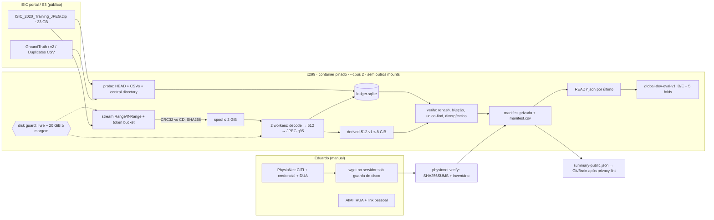

# Plano de aquisição de datasets — 19/10/2026

Status: **especificação**. Nada foi baixado, nenhum servidor foi acessado, nenhum termo
foi aceito e nenhum commit foi feito. Este documento não tira conclusão científica. Ele
define o que adquirir, como verificar, onde guardar e o que só o Eduardo pode fazer.
Complementa [dataset-protocol-update.md](dataset-protocol-update.md) (D/E, HPO único) e
[datasets.md](datasets.md) (contrato `manifest_csv`). O documento `fleet-protocol.md` é
de outro autor e não é tocado aqui.

Legenda de confiança: **[C]** confirmado em fonte primária nesta pesquisa;
**[S]** visto só em fonte secundária ou snippet; **[NC]** não confirmado, precisa
ser checado no probe ou na página oficial antes de usar.

---

## 1. Resumo por dataset

| Dataset | Licença / acesso | Tamanho bruto | Paciente | Tarefa / métrica primária | Status |
|---|---|---|---|---|---|
| **ISIC 2020 Training** (DOI 10.34970/2020-ds01) | CC BY-NC 4.0 **[C]**. Links diretos no portal, sem login identificado **[S]**. A licença por imagem no Archive varia (CC-0/CC-BY/CC-BY-NC) **[C]** | JPEG ≈ 23 GB, 33.126 imgs **[C]**. DICOM 48,9 GB e DICOM corrigido 23,0 GB **[S]**. Metadata v2 ≈ 2 MB, lista de duplicatas ≈ 2 MB (425) **[S]** | `patient_id`, 2.056 pacientes. `lesion_id` só no metadata v2 **[C]** | Binária melanoma (`target`=1) vs demais. AUROC. **Emenda de tarefa** | **Pode baixar já** (estratégia streaming, §3), depois das 4 aprovações do §7.1 |
| **mBRSET 1.0** (DOI 10.13026/qxpd-1y65) | PhysioNet credenciado + CITI + DUA **[C]** | **[NC]** (ver "Files" na página) | `patient`, 5.164 imgs / 1.291 pacientes **[C]** | DR ICDR 0–4 (`final_icdr`, grau 4 inclui pós-laser **[C]**). QWK | **Depende do Eduardo** |
| BRSET 1.0.2 (27/07/2026, DOI 10.13026/mysn-8b26) | PhysioNet credenciado + DUA **[C]** | **[NC]**. Imagens com altura 874–2304 px e largura 951–2984 px (v1.0.0) **[C]** | `patient_id`, 16.266 / 8.524 **[C]** | DR ordinal. QWK | Alternativa maior. Depende do Eduardo |
| **CheXpert v1.0** | Stanford Research Use Agreement, só pesquisa, sem redistribuição **[C]** | `CheXpert-v1.0.zip` 471,12 GB na listagem AIMI/Azure **[S]**. HF 512 px 38,3 GB, gated, com relatos de aprovação demorada **[S]**. "Small" 10,76 GB só em torrent, sem fonte oficial **[NC]** | Diretório `patientNNNNN`, 224.316 / 65.240 **[C]** | Multilabel, macro-AUROC. **O trainer ainda não suporta multilabel** | Depende do Eduardo **e** de implementação. Última prioridade |
| MIMIC-CXR-JPG 2.1.0 | PhysioNet credenciado + CITI + DUA **[C]** | 377.110 JPG **[C]**. Total ≈ 570 GB **[NC]** | `subject_id` | Multilabel | Alternativa. Não cabe no servidor sem a estratégia streaming |

Ordem recomendada: **ISIC → mBRSET → (BRSET) → CheXpert/MIMIC**. Motivo: segue o que o
trainer já suporta (classes exclusivas antes de multilabel) e o que depende só de nós.

---

## 2. Restrições operacionais assumidas

- Servidor x299, `/home` com ≈ 41,09 GB livres = **38,27 GiB**. A reserva obrigatória de
  20 GiB deixa **≈ 18,27 GiB úteis**. `/` tem 117 GiB livres, mas sem diretório
  persistente gravável pelo usuário.
- Tudo roda no servidor, nunca no notebook. Rede e orquestração usam a stdlib do Python
  3.12. Decodificação e redimensionamento usam Pillow dentro da imagem Docker pinada
  (digest registrado).
- No máximo 2 cores de CPU, banda limitada e configurável. Nenhuma saída existente é
  apagada. O único arquivo que a ferramenta apaga é o spool que ela mesma criou (§3.4).
- Manifestos com IDs ficam **privados** em `~/augment-atlas-private/`. Git e Brain recebem
  apenas agregados e hashes.

---

## 3. ISIC 2020: comparação de estratégias e escolha

### 3.1 Fontes oficiais a usar (validar com HEAD no probe)

Página: <https://challenge.isic-archive.com/data/#2020> (DOI <https://doi.org/10.34970/2020-ds01>).
Os nomes abaixo seguem o padrão histórico do bucket do portal. **[NC]**: o probe
precisa copiar os links do botão da página. URL construída à mão não vale.

| Papel | Nome esperado | Tamanho |
|---|---|---|
| Imagens | `ISIC_2020_Training_JPEG.zip` | ≈ 23 GB **[C]** |
| Rótulo + paciente | `ISIC_2020_Training_GroundTruth.csv` (`image_name, patient_id, sex, age_approx, anatom_site_general_challenge, diagnosis, benign_malignant, target`) **[NC nas colunas]** | ≈ 2 MB **[S]** |
| Paciente + lesão | `ISIC_2020_Training_GroundTruth_v2.csv` (acrescenta `lesion_id`) **[S]** | ≈ 2 MB **[S]** |
| Duplicatas | `ISIC_2020_Training_Duplicates.csv` (425 pares) **[S no conteúdo, NC no nome/colunas]** | ≈ 2 MB **[S]** |
| Teste oficial (10.982 imgs, ≈ 6,7 GB, **sem rótulos públicos**) | **não baixar** | — |

**Checksums oficiais: não encontrados.** Nem o ISIC nem o DOI publicam SHA256/MD5. A
identidade fica sendo: ETag + Content-Length + Last-Modified do objeto, CRC32 de cada
membro conferido contra o central directory do ZIP, e os hashes que nós calculamos.
**Variante redimensionada oficial: não encontrada.** As versões 224/256 do Kaggle são de
terceiros, com cadeia de licença e bytes não verificáveis contra o DOI, e por isso foram
descartadas. Os TFRecords 1024 da competição Kaggle exigem aceitar regras de competição
**[NC]**, e por isso também foram descartados.

### 3.2 Comparação

| Critério | (a) Streaming do ZIP + derivado | (b) API por imagem | (c) Diretório em `/` (sudo) |
|---|---|---|---|
| Espaço de pico | ≈ 11,5 GiB (derivado ≤ 8 + spool 2 + meta/margem 1,5) | ≈ derivado | 23 GB brutos + derivado ≈ 27–30 GiB |
| Tempo | Download 23 GB (≈ 15–40 min a 10–25 MiB/s), mais ≈ 1,5–3 h de CPU em 2 cores | 33k requisições, com rate limit **[NC]** e horas de latência | Download igual a (a), depois a mesma derivação |
| Verificabilidade | CRC32 por membro vs CD, SHA256 por original, hash raiz por chunks do ZIP, ETag | Fraca: bytes do Archive podem diferir do release DOI e o schema `files`/hash **[NC]** | Máxima: ZIP bruto retido, `sha256sum`, `unzip -t` |
| Reprodutibilidade | Alta: o release DOI é recriável e o derivado é determinístico na imagem pinada | Média: o Archive é vivo e a licença é por imagem | Alta |
| Risco | Parser ZIP64 próprio (mitigado por testes); originais não retidos | Divergência de release, throttling | Depende do Eduardo; encher `/` derruba o SO |
| Depende do Eduardo | Não | Não | **Sim** |

**Decisão: (a).** Cabe na folga atual, não depende de sudo e não põe o filesystem do SO
em risco. A integridade é conferida membro a membro. Pedir (c) **em paralelo** para os
datasets seguintes, porque mBRSET + BRSET + CheXpert não cabem nos ≈ 12 GiB que sobram
depois do ISIC.

### 3.3 Derivado e emenda de pré-processamento

`preprocessing_id = "isic2020-derived-512-v1"`. É uma etapa determinística que precisa
entrar no protocolo e no manifest. Ela é aplicada **antes** do trainer, que hoje ainda faz
um resize bilinear quadrado para 224 (`train.py`, sem preservar o aspecto).

1. Decodificar os bytes do membro com Pillow da imagem pinada. Registrar
   `PIL.__version__` e a versão do libjpeg-turbo.
2. **Sem** `exif_transpose`. Contar e registrar imagens com Orientation ≠ 1 e imagens com
   perfil ICC.
3. Aplicar `convert("RGB")`. Registrar o modo original quando não for RGB.
4. Redimensionar mantendo o aspecto até o **lado menor = 512**. Usar LANCZOS e
   `reducing_gap=None`. O lado maior é `round(long*512/short)`. **Nunca ampliar**: se o
   lado menor já é < 512, manter o tamanho e contar.
5. Codificar em JPEG com `quality=95`, `subsampling=0` (4:4:4), sem progressive, sem
   optimize, sem EXIF/ICC.
6. Registrar, por imagem: `sha256_original`, `crc32` confirmado, dimensões originais,
   `sha256_derived` (bytes do arquivo) e `pixel_sha256` (RGB decodificado do derivado na
   imagem pinada). O último detecta decodificadores diferentes.

Estimativa de tamanho: o aspecto típico é 3:2, ou seja ≈ 768×512 = 0,39 MP. A 2–3,5 bpp
(q95 4:4:4), isso dá **≈ 100–170 KB por imagem**, ou **≈ 3,3–5,6 GB** no total. Meta
≤ 6 GiB, **teto rígido 8 GiB**. A projeção sai do canary (§3.4, passo 6).

Alternativas descartadas:
- Lado menor 768: 2,25× mais pixels, ≈ 7,5–12,5 GB, come a folga dos outros datasets.
- PNG 512: ≈ 0,6–0,7 MB por imagem, ≈ 20–23 GB, não cabe.
- PNG 256 sem perda: cabe (≈ 6–7 GB), mas trava a resolução em ≤ 256 para sempre.

Consequências para o protocolo:
- Há dupla compressão com perda (original JPEG → q95). O baseline já não é a imagem
  intocada.
- 512→224 bilinear não é idêntico a original→224.
- No backend legado (augmentation antes do resize), o kernel do CLAHE é
  `window_fraction*largura` e passa a depender da largura 512. No candidate-v2 (resize
  antes) isso não muda.
- Essas três consequências entram como emenda explícita.

### 3.4 Algoritmo da ferramenta de aquisição (pseudocódigo de interface)

CLI proposta (stdlib, exceto `derive`):
`python -I -m augment_atlas.acquisition isic2020 {probe|run|verify|summarize} --config <json> --root <dir>`

**Entradas.** `configs/acquisition/isic2020-derived-512-v1.json` é público e não tem IDs.
Contém: URLs copiadas da página, contagens documentadas (33.126 imagens, 2.056 pacientes,
584 melanomas, 425 duplicatas, 32.701 lesões segundo o Archive), parâmetros de
pré-processamento, `reserve_gib=20`, `derived_cap_gib=8`, `spool_cap_gib=2`,
`max_rate_mib_s=25`, `workers=2`, `chunk_bytes=32 MiB`, além de `split_seed` e frações D/E
fixados **antes** do download.

**Saídas privadas** em `~/augment-atlas-private/datasets/isic2020/`:

```
acquisition-v1/            # estado da ferramenta (privado)
  config.json              # cópia exata + sha256
  lock                     # flock: impede 2 instâncias
  ledger.sqlite            # estado por membro e por chunk (WAL, transacional)
  http/                    # cabeçalhos HEAD/206 de cada sessão (sem tokens)
  central-directory.bin    # bytes do CD + sha256
  spool/                   # TRANSITÓRIO: originais aguardando derivação
release/                   # CSVs oficiais pequenos, retidos byte a byte
derived-512-v1/images/ISIC_NNNNNNN.jpg
manifest/
  manifest-private.json    # schema §4.1
  manifest.csv             # path,group,label,sha256 (contrato manifest_csv)
  records.json             # id/path/group/label (entrada do gerador de splits)
  divergences.json
  READY.json               # escrito POR ÚLTIMO; sem ele, o dataset não existe
```

**Passos de `run`:**

1. **Lock e pré-checagem de disco.** Usar `statvfs(/home)` com `f_bavail*f_frsize`.
   Exigir `livre − 20 GiB ≥ derived_cap + spool_cap + 1,5 GiB` (≈ 11,5 GiB, ou seja
   livre ≥ 31,5 GiB). Se falhar: sair com 75 sem escrever nada.
2. **Probe (idempotente).** Fazer HEAD de cada URL e exigir `Accept-Ranges: bytes`,
   Content-Length, ETag e Last-Modified. Baixar os 3 CSVs (só alguns MB) para `release/`
   com SHA256. Em sessões posteriores, ETag ou tamanho diferente → **exit 3** (o objeto
   mudou; decisão humana).
3. **Central directory.** Pedir `Range: bytes=-131072` e localizar EOCD → locator ZIP64 →
   EOCD64. Depois pedir o range do CD e fazer o parse das entradas: nome, método, flags,
   CRC32, tamanhos (ZIP64 extra), offset do local header.
4. **Validação estrutural** (falha = exit 2):
   - métodos aceitos: {0 stored, 8 deflate};
   - flag de criptografia proibida;
   - nomes únicos;
   - os nomes **nunca viram caminho**: só `^(prefixo/)?ISIC_\d{7}\.jpg$` gera saída, e
     com nome reconstruído; diretórios e lixo (`__MACOSX`, `.DS_Store`) são contados e
     ignorados;
   - os intervalos `[offset, offset+header+csize(+descriptor))` são disjuntos e
     contíguos;
   - o número de `.jpg` deve ser igual a 33.126 e haver bijeção com `image_name` do
     GroundTruth. Uma diferença aqui vira divergência e **bloqueia o READY**, mas não o
     download.
5. **Plano de retomada.** O ledger tem `member(state ∈ PENDING|FETCHED|DERIVED|SKIPPED)` e
   `chunk(k, sha256)`. O offset de retomada é
   `r = min(C·k_done, ⌊next_header_offset/C⌋·C)`. Pedir `GET Range: bytes=r-` com
   `If-Range: <ETag>` e exigir **206** com Content-Range coerente. Um 200 na retomada é
   abortado. Chunks reprocessados precisam bater com o hash já gravado (verificação
   extra grátis).
6. **Laço de streaming.** O token bucket limita a banda. Para cada membro em ordem de
   offset:
   - ler o local header e conferir assinatura e nome contra o CD;
   - ler `csize` bytes e inflar (deflate raw) ou copiar;
   - conferir `crc32` e `usize` **contra o CD**;
   - calcular SHA256 do original;
   - gravar `spool/<id>.jpg.tmp`, depois fsync, rename e transação `FETCHED`.

   Todos os bytes passam pelo hasher do chunk corrente. O chunk só é gravado completo,
   numa única sessão.
7. **Workers de derivação** (2 processos, `--cpus 2`): pegar um `FETCHED`, derivar
   (§3.3), gravar `.tmp`, fsync, rename e transação `DERIVED` com os hashes, e só então
   remover o arquivo do spool. `Image.MAX_IMAGE_PIXELS` fica no padrão e o aviso vira
   erro (`SKIPPED`, com motivo registrado, contado como divergência).
8. **Backpressure.** Com spool > `spool_cap`, o downloader **fecha a conexão**, espera
   até spool < cap/2 e retoma pelo passo 5. Isso evita conexão ociosa derrubada pelo S3.
9. **Guarda de disco durante o run.** Antes de cada escrita de `s` bytes, exigir
   `livre − s − 20 GiB ≥ 1 GiB`. A guarda mede o livre **real**, então também cobre
   checkpoints de jobs GPU. Se falhar: parar limpo, sem `.tmp` pendente, exit 75.
10. **Canary e projeção.** Depois de 500 derivados e a cada 2.000, calcular
    `projeção = média_derivado × 1,3 × restantes + já_gravado`. Se passar de
    `derived_cap`, exit 3. A ordem por offset pode agrupar instituições, daí o fator 1,3.
11. **Fim do stream.** Calcular `zip_chunked_root = sha256(concat(sha256 de cada chunk))`.
    É a identidade canônica, invariante a quedas. O SHA256 simples do ZIP só é
    registrado se tudo veio numa sessão única; senão fica `null`, com o motivo.
12. **Falhas de rede.** Timeout de 60 s e backoff exponencial, no máximo 8 tentativas por
    sessão; depois disso, exit 75. Nenhum estado parcial vira `DERIVED`.

**`verify`** (também roda no final do `run`):
- spool vazio e zero `.tmp`;
- número de arquivos em `derived-512-v1/images` igual ao número de `DERIVED`;
- SHA256 de **todos** os derivados recalculado (≈ 5 GB) e igual ao ledger;
- todo `image_name` do CSV com membro e vice-versa;
- reconciliação de duplicatas e grupos (§3.5);
- contagens observadas vs documentadas em `divergences.json`, cada divergência com
  `accepted: false` até haver decisão registrada.

Só com todas as checagens OK e nenhuma divergência pendente ele grava `manifest/*`, e por
último `READY.json` (hashes de todos os arquivos de `manifest/` e do config). Os
consumidores exigem o `READY.json`, conferem esses hashes e fixam `manifest.csv` via
`dataset.manifest_sha256` com `require_image_hashes: true`.

**Códigos de saída.** 0 = READY. 75 = pausado, pode retomar (disco ou rede). 2 = falha de
integridade, sem retry automático. 3 = documento ou objeto divergente, precisa de decisão
humana.

**Execução.** `docker run` na imagem pinada com:
- `--cpus 2 --memory 4g --pids-limit 256`;
- `--user <uid>:<gid> --read-only --tmpfs /tmp --cap-drop ALL --security-opt no-new-privileges`;
- o código montado read-only, e **só** `.../datasets/isic2020` montado read-write;
- rede padrão, porque o download roda no mesmo processo;
- dentro de `tmux` e com `nice`/`ionice -c3`.

Pode conviver com uma campanha GPU, porque a guarda mede o disco real.

### 3.5 Duplicatas, grupos e rótulos

- **Grupo = componente conexo (union-find)** de `patient_id`, ligado por qualquer par de
  duplicata: os 425 pares oficiais e os SHA256 de originais idênticos, calculados de
  graça. Se um par cruza pacientes, os dois pacientes caem no mesmo grupo. Isso evita
  vazamento entre treino e teste. O `group` no CSV é `isic20-g-` + sha256(sorted
  patient_ids)[:16].
- `patient_id` vazio ou ausente → falha. Nunca imputar com o ID da imagem.
- `label = int(target)`. Conferir `target==1 ⇔ diagnosis=="melanoma"` e
  `benign_malignant`. Inconsistência vira divergência.
- **Política de duplicatas (decisão do Eduardo, §7.1).** Default proposto: manter **um**
  representante por componente de duplicata exata (o menor `image_name`) e excluir os
  demais com motivo registrado, para não contar a mesma imagem duas vezes na avaliação.
  Par com rótulos conflitantes: excluir os dois e registrar.
- Quase-duplicatas (dHash 64-bit do derivado, distância ≤ 4) entram **só como
  relatório**, sem excluir nada. Cassidy et al. 2022 relatam muito mais sobreposição
  entre releases ISIC; dentro do 2020, o oficial são 425.

---

## 4. Schemas

### 4.1 Manifesto privado (`manifest-private.json`, por dataset)

```json
{
  "schema": "augment-atlas/dataset-manifest-private/v1",
  "dataset": {"name": "isic2020", "release": "ISIC 2020 Challenge Training",
              "doi": "10.34970/2020-ds01", "license": "CC-BY-NC-4.0",
              "task": "binary-melanoma-vs-rest", "label_column": "target",
              "patient_column": "patient_id"},
  "acquisition": {
    "tool_commit": "<git sha>", "config_sha256": "<hex>", "docker_image_digest": "sha256:<hex>",
    "decoder": {"pillow": "<ver>", "libjpeg_turbo": "<ver>"},
    "sources": [{"role": "images_zip", "url": "<sem query string>", "content_length": 0,
                 "etag": "<etag>", "last_modified": "<http-date>",
                 "sha256": "<hex|null>", "sha256_null_reason": "multi-session",
                 "chunked_sha256": {"chunk_bytes": 33554432, "n_chunks": 0, "root": "<hex>"},
                 "central_directory_sha256": "<hex>"},
                {"role": "ground_truth_csv", "url": "...", "sha256": "<hex>", "bytes": 0}],
    "sessions": [{"start_utc": "...", "end_utc": "...", "range_start": 0, "range_end": 0, "exit": 75}]
  },
  "preprocessing": {"id": "isic2020-derived-512-v1", "short_side": 512, "upscale": false,
                    "resample": "LANCZOS", "reducing_gap": null, "exif_transpose": false,
                    "format": "JPEG", "quality": 95, "subsampling": "4:4:4", "keep_icc": false},
  "documented_counts": {"images": 33126, "patients": 2056, "melanoma_images": 584,
                        "duplicate_pairs": 425, "lesions_archive": 32701},
  "observed_counts": {"zip_jpg_members": 0, "csv_rows": 0, "patients": 0, "melanoma_images": 0,
                      "lesions": 0, "duplicate_pairs_official": 0, "duplicate_pairs_exact_hash": 0,
                      "near_duplicate_pairs": 0, "exif_orientation_ne_1": 0, "icc_present": 0,
                      "non_rgb_mode": 0, "short_side_lt_512": 0, "skipped": 0},
  "divergences": [{"field": "...", "documented": 0, "observed": 0, "source_url": "...",
                   "accepted": false, "resolution": null, "decided_by": null}],
  "duplicates": {"policy": "keep-min-image-name-v1",
                 "pairs": [{"a": "ISIC_x", "b": "ISIC_y", "source": "official|exact-sha256|near-dhash",
                            "same_patient": true, "label_conflict": false}],
                 "excluded": [{"image": "ISIC_y", "reason": "duplicate-of:ISIC_x"}]},
  "groups": {"algorithm": "patient-union-duplicates-v1", "n_groups": 0,
             "patient_to_group": {"IP_xxxxxxx": "isic20-g-<hex16>"}},
  "records": [{"image": "ISIC_xxxxxxx", "patient_id": "IP_xxxxxxx", "lesion_id": "IL_xxxxxxx",
               "group": "isic20-g-<hex16>", "label": 0, "diagnosis": "<texto>",
               "status": "included|excluded|skipped", "reason": null,
               "original": {"zip_member": "<nome>", "crc32": "<hex8>", "compressed_size": 0,
                            "size": 0, "sha256": "<hex>", "width": 0, "height": 0, "mode": "RGB",
                            "exif_orientation": 1, "icc": false},
               "derived": {"path": "isic2020/derived-512-v1/images/ISIC_xxxxxxx.jpg",
                           "sha256": "<hex>", "bytes": 0, "width": 0, "height": 0,
                           "pixel_sha256": "<hex>"}}],
  "outputs": {"manifest_csv": {"sha256": "<hex>", "rows": 0},
              "records_json": {"sha256": "<hex>", "rows": 0}},
  "sha256": "<canonical_hash do documento sem esta chave>"
}
```

O mesmo schema vale para mBRSET, BRSET e CheXpert. Nesses casos, `sources` vem do
`SHA256SUMS.txt` do PhysioNet (ou do inventário AIMI), `zip_member` é substituído por
`release_path`, e `preprocessing` pode ser `"none"` (bytes originais).

### 4.2 Sumário público agregado (`<dataset>-summary-public.json`, vai para Git/Brain)

```json
{
  "schema": "augment-atlas/dataset-summary-public/v1",
  "dataset": "isic2020", "release_doi": "10.34970/2020-ds01", "license": "CC-BY-NC-4.0",
  "preprocessing_id": "isic2020-derived-512-v1",
  "tool_commit": "<sha>", "docker_image_digest": "sha256:<hex>",
  "source_identity": {"etag": "<etag>", "content_length": 0, "chunked_sha256_root": "<hex>"},
  "hashes": {"manifest_private_sha256": "<hex>", "manifest_csv_sha256": "<hex>",
             "records_json_sha256": "<hex>", "ready_sha256": "<hex>"},
  "counts": {"images_included": 0, "images_excluded": 0, "groups": 0, "patients": 0,
             "class_images": {"0": 0, "1": 0}, "class_groups": {"0": 0, "1": 0},
             "mixed_label_groups": 0,
             "images_per_group_quantiles": {"p10": 0, "p50": 0, "p90": 0}},
  "duplicates": {"official_pairs": 0, "exact_hash_pairs": 0, "near_pairs_reported": 0,
                 "cross_patient_pairs": 0, "label_conflict_pairs": 0},
  "divergences": [{"field": "...", "documented": 0, "observed": 0, "accepted": true}],
  "derived_bytes_total": 0,
  "privacy_lint": {"pattern_hits": 0, "patterns": ["ISIC_\\d{7}", "IP_\\d{7}", "IL_\\d{7}"]}
}
```

`summarize` falha se `privacy_lint.pattern_hits > 0`. Nada de máximo de imagens por
paciente, listas, hashes por grupo ou caminhos.

---

## 5. Splits D/E por paciente para ISIC (sem treino)

O algoritmo `global-dev-eval-v1` é novo e só stdlib, sem dependência de versão do
sklearn. Ele é distinto do `stratified-group-outer-v1`, que é within-outer-fold.

1. **Unidade:** o grupo do §3.5. **Estratos:** `positivo = ∃ imagem target=1` × quartil
   de nº de imagens por grupo.
2. **D/E:** em cada estrato, ordenar os grupos por `sha256([alg, split_seed, "DE", group])`
   e mandar os primeiros `round(0,20·n)` para **D**.
3. **D_fit/D_select:** o mesmo procedimento com o estágio `"D-select"`, fração
   `f_sel` (decisão: 0,20 ou 0,30).
4. **E → 5 folds:** em cada estrato, ordenar por hash do estágio `"E-folds"` e fazer
   round-robin 0..4.
5. **Auditorias pass/fail, sem retry de seed:**
   - cobertura exatamente uma vez e grupos disjuntos entre D_fit, D_select e E_f;
   - ambas as classes em todos os pools;
   - limiares **pré-registrados**: D_select ≥ 15 grupos positivos e cada E_f ≥ 50 grupos
     positivos;
   - contagens de imagens, positivas e grupos por pool.

   Se reprovar, parar e escalar. Não existe fallback automático.
6. **Ordem de grandeza esperada.** 20,8% dos pacientes têm ≥ 1 melanoma, ≈ 428 grupos
   positivos. Isso dá: D ≈ 411 grupos (≈ 86 positivos); D_select ≈ 82 (≈ 17 positivos)
   com `f_sel=0,20` ou ≈ 123 (≈ 26) com 0,30; cada E_f ≈ 329 (≈ 68 positivos, ≈ 93
   melanomas). São estimativas a confirmar no `verify`, não resultados. Com 0,20 o
   D_select fica perto do limiar, por isso a recomendação é **`f_sel=0,30`**.
7. **Saídas privadas** em `.../isic2020/splits/global-dev-eval-v1/`: `pools.json` e
   `folds.json` com `canonical_hash`. O público recebe só contagens e hashes.
   `split_seed` e as frações ficam no config **antes** do download.
8. **Limite do código atual.** `manifest_csv` + `splits.json` exigem train/selection/test
   cobrindo o manifest inteiro, e `selection-only` exige `within-outer-fold`. Os pools
   D/E dependem da extensão já listada como pendente em dataset-protocol-update.md. Aqui
   só fica especificado o artefato.

---

## 6. Diagrama



---

## 7. Checklist do Eduardo

### 7.1 Antes do ISIC (decisões, nenhuma ação em servidor)

- [ ] Confirmar uso **não comercial** e atribuição (CC BY-NC 4.0, citar o DOI e o
      descriptor). Derivados não são redistribuídos.
- [ ] Aprovar a **emenda de tarefa**: ISIC2020 binário `target` (melanoma vs demais),
      AUROC primária.
- [ ] Aprovar `isic2020-derived-512-v1` (lado menor 512, JPEG q95 4:4:4, sem ampliar)
      ou escolher outra resolução **antes** do download.
- [ ] Aprovar a política de duplicatas (default no §3.5) e o agrupamento union-find.
- [ ] Fixar `split_seed`, D=0,20 e `f_sel` (recomendado 0,30). Uma seed só, sem retry.
- [ ] Autorizar o run no x299 (2 cores, `max_rate` 25 MiB/s, ou o valor que ele preferir).

### 7.2 Diretório persistente em `/` (recomendado para os próximos datasets)

- [ ] Ele mesmo, com sudo: criar um diretório dono do usuário com modo 700 (ex.
      `/srv/augment-atlas-data`). Confirmar com `df -h` e `findmnt` que é disco
      persistente e não tmpfs.
- [ ] Definir uma reserva para `/` de pelo menos 30 GiB, porque é o FS do SO. Informar o
      caminho e a reserva. Nada de senha.

### 7.3 PhysioNet (mBRSET 1.0, BRSET 1.0.2, MIMIC-CXR-JPG 2.1.0)

1. Criar conta em <https://physionet.org/register/>, de preferência com e-mail
   institucional.
2. Fazer o CITI em <https://physionet.org/about/citi-course/>:
   - em citiprogram.org: *Register* → organização **"Massachusetts Institute of
     Technology Affiliates"**;
   - no questionário, escolher o curso **"Data or Specimens Only Research"** e
     concluir;
   - baixar o **Completion Report** (não o certificado).
3. No PhysioNet, em *Settings → Training*, enviar o report. Em *Settings →
   Credentialing*, preencher identidade, instituição, resumo de pesquisa e
   **referência** (para aluno, o orientador). Pedir ao orientador que responda rápido. A
   PhysioNet já avisou de atrasos de semanas na revisão. Conferir o formulário vigente,
   porque o fluxo mudou em 2022.
4. Depois de aprovado, em cada página
   (<https://physionet.org/content/mbrset/1.0/>,
   <https://physionet.org/content/brazilian-ophthalmological/1.0.2/>,
   <https://physionet.org/content/mimic-cxr-jpg/2.1.0/>): seção *Files* → **ler e assinar
   o DUA** pessoalmente. Anotar o "Total uncompressed size" e o nome da licença.
5. **Antes de baixar**, me mandar o tamanho total. Eu confirmo se cabe na folga
   (`livre − reserva`). MIMIC integral (≈ 570 GB **[NC]**) não cabe: baixar só
   `SHA256SUMS.txt` e os CSVs até haver uma estratégia derive-on-ingest por arquivo.
6. No servidor, **ele mesmo**, dentro de `tmux`, no diretório de destino, rodar o wget
   sob o wrapper de guarda de disco (`augment_atlas.acquisition guard -- wget ...`). O
   wrapper só monitora o `statvfs` e encerra o wget se a reserva for atingida. Ele nunca
   lê a senha, porque o wget lê do TTY:
   `wget -r -N -c -np --user <usuario> --ask-password https://physionet.org/files/mbrset/1.0/`
   Nunca usar `--password=`, `.wgetrc` ou `.netrc` (ficam em histórico, `ps` e disco).
   Conferir o comando exato exibido na seção *Files*.
7. Rodar `sha256sum -c SHA256SUMS.txt` no diretório da release, ou a ferramenta
   `physionet verify`, que faz o mesmo e gera o inventário.

**O que me devolver.**
- Caminho absoluto no servidor, versão e data.
- Saída resumida da verificação (N OK / N FAILED).
- `du -sb` e o nome e versão do DUA assinado.
- **Nunca** usuário/senha, cookies, tokens ou links assinados.

### 7.4 CheXpert (adiar até existir treino multilabel e armazenamento em `/`)

1. Página oficial: <https://stanfordmlgroup.github.io/competitions/chexpert/> → AIMI
   <https://aimi.stanford.edu/datasets/chexpert-chest-x-rays> (listagem Azure:
   <https://stanfordaimi.azurewebsites.net/datasets/8cbd9ed4-2eb9-4565-affc-111cf4f7ebe2>).
   Fazer login, **ler e aceitar o RUA pessoalmente** e obter o link de download. Esse link
   é pessoal, temporário e não pode ser compartilhado.
2. Opções:
   - zip completo, 471 GB **[S]**: derive-on-ingest pela mesma ferramenta de streaming,
     com o Eduardo colando a URL num prompt `getpass` do próprio processo. A URL nunca é
     gravada e os logs tiram a query string;
   - HF `StanfordAIMI/CheXpert-v1.0-512`, 38,3 GB **[S]**: pedir acesso, usar token
     fine-grained só-leitura em variável de ambiente da sessão e **revogar** o token
     depois.
   - Não usar mirrors "small" do Kaggle/torrent: redistribuição é vedada e a fonte não é
     verificável.
3. Devolver: caminho, inventário e hashes, versão do RUA. Nunca o link ou o token.

---

## 8. Divergência documental do mBRSET

O artigo (Sci Data 2025, Tabela de imagens) traz `final_icdr`: 281 ausentes, mais
3.750/272/568/82/212 nos graus 0–4. Isso soma **5.165**, contra **5.164** imagens
declaradas. É uma imagem de diferença, sem explicação nas fontes
([PMC11846882](https://pmc.ncbi.nlm.nih.gov/articles/PMC11846882/)). O preprint
(medRxiv 2024) pode trazer outros números.

Resolução, sem corrigir nada à mão:
1. Verificar o CSV de rótulos pelo `SHA256SUMS.txt` da release 1.0. O hash da release é a
   verdade.
2. Contar no próprio arquivo: linhas, imagens existentes, pacientes únicos (`patient`),
   ausentes e vazios por coluna, distribuição de `final_icdr`.
3. Registrar em `divergences[]` uma tabela documentado (artigo e preprint, com URL) vs
   observado.
4. Política pré-registrada: imagens sem `final_icdr` **ficam fora do manifest da tarefa
   DR**, contadas por motivo. O paciente continua no grupo pelas outras imagens. Rótulo
   não é imputado, e um arquivo listado sem imagem ou uma imagem sem linha é divergência
   que bloqueia o READY.
5. Auditar também: `patient` nulo ou inconsistente, imagens repetidas (SHA256) e
   namespace. O BRSET usa `patient_id` e outra população, e não se misturam IDs entre
   releases.

---

## 9. Estrutura proposta no repositório (só spec)

```
src/augment_atlas/acquisition/
  __init__.py
  cli.py            # isic2020 probe|run|verify|summarize; physionet verify; guard -- <cmd>
  http_range.py     # HEAD/Range/If-Range, token bucket, backoff (stdlib)
  zipstream.py      # EOCD/ZIP64/CD parse, validação estrutural, iterador sequencial (stdlib)
  ledger.py         # sqlite3 WAL: membros, chunks, sessões
  diskguard.py      # statvfs, reserva, margem, pausa limpa (exit 75)
  derive.py         # Pillow: preprocessing_id → derivado + pixel_sha256 (só no container)
  isic2020.py       # reconciliação CSV↔ZIP, union-find, duplicatas, manifest
  physionet.py      # SHA256SUMS verify + inventário (stdlib)
  summary.py        # sumário público + privacy lint
  splits_global.py  # global-dev-eval-v1 (stdlib)
configs/acquisition/isic2020-derived-512-v1.json   # público, sem IDs
tests/acquisition/  # ZIP64 sintético (stored+deflate+data descriptor), servidor Range local
                    # com quedas injetadas, ETag trocado, disco cheio simulado, nomes hostis
```

O ponto de integração é o contrato existente: `manifest.csv` em
`path,group,label,sha256`, consumido por `data.load_records` sem mudança, e `records.json`
para os splits.

---

## 10. Fases

| Fase | Entrega | Critério de pronto |
|---|---|---|
| F0 | Decisões do §7.1 registradas | Config público com seed, frações, preprocessing e política de duplicatas, hash commitado antes de qualquer download |
| F1 | Ferramenta + testes offline | Testes com ZIP64 sintético ≥ 4 GiB lógico (ou via offsets forçados), quedas em 3 pontos, 200 na retomada abortado, ETag trocado → exit 3, disco simulado → exit 75 sem `.tmp`, nomes `../` ignorados. Nenhum acesso de rede |
| F2 | Probe no servidor | HEAD OK com Range; CD com 33.126 `.jpg` (ou divergência registrada); CSVs com contagens documentadas; tamanhos reais anotados |
| F3 | Canary de 500 imagens | Projeção ≤ 6 GiB (≤ 8 GiB rígido); tempo/imagem medido; `pixel_sha256` reproduzido em 2 execuções |
| F4 | Run completo | Ledger 100% `DERIVED`/`SKIPPED` justificado; spool vazio; reserva nunca violada (log da guarda) |
| F5 | Verify + READY + sumário | Todos os rehashes OK; divergências decididas; `READY.json`; sumário público com lint 0 |
| F6 | Splits D/E | `global-dev-eval-v1` passa nas auditorias pré-registradas, sem retry; só contagens e hashes saem do servidor |
| F7 | PhysioNet / CheXpert | Após o §7.3/§7.4: `physionet verify` OK, manifest + READY e divergência do mBRSET resolvida |

---

## 11. ADRs curtos

- **ADR-A1 Streaming derive-on-ingest para ISIC.** Contexto: 23 GB brutos e ≈ 18 GiB
  úteis. Decisão: estratégia (a). Consequência: os originais não ficam retidos; a
  reprodução exige baixar de novo o release DOI, o que é aceitável porque o release é
  público e citável.
- **ADR-A2 Derivado 512 / JPEG q95 4:4:4.** Contexto: o treino é a 224 e o espaço é
  curto. Decisão: lado menor 512, sem ampliar. Consequência: dupla compressão documentada
  como emenda, mas mantém margem para 448 no futuro.
- **ADR-A3 Integridade sem checksum oficial.** Contexto: o ISIC não publica hashes.
  Decisão: CRC32 vs CD + SHA256 por membro + raiz por chunks + ETag. Consequência:
  conseguimos detectar corrupção e troca do objeto, mas não autenticar contra o
  publicador.
- **ADR-A4 Um container, ledger SQLite.** Contexto: um pesquisador solo, que precisa
  retomar depois de quedas. Decisão: um processo downloader + 2 workers, `sqlite3` da
  stdlib. Consequência: arquitetura simples. A rede convive com a decodificação de JPEG
  não confiável, risco mitigado com non-root, read-only, cap-drop e mount mínimo.
- **ADR-A5 Grupo = union-find(paciente, duplicatas).** Contexto: duplicatas podem cruzar
  pacientes. Decisão: fundir os componentes. Consequência: há menos grupos que os 2.056
  pacientes se houver cruzamento, e isso é reportado.
- **ADR-A6 Credenciais só com o Eduardo.** Contexto: DUA e RUA são pessoais. Decisão: ele
  aceita os termos e roda o wget ou o prompt; nós só verificamos. Consequência: o
  cronograma depende da aprovação PhysioNet, que leva semanas.
- **ADR-A7 Split stdlib por hash e estrato.** Contexto: listas reprodutíveis
  independentes da versão do sklearn. Decisão: `global-dev-eval-v1`. Consequência: o
  equilíbrio de imagens por fold é aproximado e auditado, não otimizado.

## 12. Riscos

| Risco | Mitigação |
|---|---|
| URL ou objeto do ISIC muda (ETag) | Exit 3, re-probe; o config guarda os links copiados da página |
| Servidor sem Range | Fallback com stream único e sem retomada (recomeça do zero); o disco ainda cabe |
| Layout do ZIP inesperado (ZIP64, data descriptor, prefixo de pasta) | Parser testado com essas variantes; validação de contiguidade |
| Disco disputado por jobs GPU | A guarda mede o livre real; pausa limpa com exit 75 |
| Decodificador diferente (libjpeg) | Só a imagem pinada; `pixel_sha256` |
| Quase-duplicatas além das 425 | Relatório dHash, sem exclusão silenciosa |
| Vazamento de IDs | Tudo privado; lint de regex no sumário; logs privados |
| Licença por imagem ≠ agregada | Usar a agregada CC BY-NC do release; não redistribuir |
| Atraso de credenciamento | Começar o §7.3 já, em paralelo ao ISIC |
| `/` cheio derruba o SO | Reserva própria ≥ 30 GiB; só usar após criação explícita pelo Eduardo |
| CheXpert e MIMIC não cabem | Adiar; derive-on-ingest ou armazenamento novo |

## Fontes

- ISIC: <https://challenge.isic-archive.com/data/#2020>, <https://doi.org/10.34970/2020-ds01>,
  <https://api.isic-archive.com/collections/70/>, descriptor
  <https://www.nature.com/articles/s41597-021-00815-z> (correções 10.1038/s41597-021-00865-3,
  10.1038/s41597-021-00879-x), AWS Open Data <https://registry.opendata.aws/isic-archive/>,
  isic-cli <https://github.com/ImageMarkup/isic-cli>, duplicatas entre releases
  <https://e-space.mmu.ac.uk/631025>.
- PhysioNet: <https://physionet.org/content/mbrset/1.0/>,
  <https://physionet.org/content/brazilian-ophthalmological/1.0.2/>,
  <https://physionet.org/content/mimic-cxr-jpg/2.1.0/>, CITI
  <https://physionet.org/about/citi-course/>, mudanças de credenciamento
  <https://physionet.org/news/post/394/>, atrasos <https://physionet.org/news/post/397/>.
- mBRSET: <https://pmc.ncbi.nlm.nih.gov/articles/PMC11846882/>,
  <https://www.medrxiv.org/content/10.1101/2024.07.11.24310293v1.full.pdf>.
- CheXpert: <https://stanfordmlgroup.github.io/competitions/chexpert/>,
  <https://stanfordaimi.azurewebsites.net/datasets/8cbd9ed4-2eb9-4565-affc-111cf4f7ebe2>,
  <https://aimi.stanford.edu/datasets/chexpert-plus>,
  <https://huggingface.co/datasets/StanfordAIMI/CheXpert-v1.0-512>,
  <https://discuss.huggingface.co/t/access-to-the-gated-repository-stanfordaimi-chexpert-v1-0-512/180567>,
  <https://arxiv.org/abs/1901.07031>.
