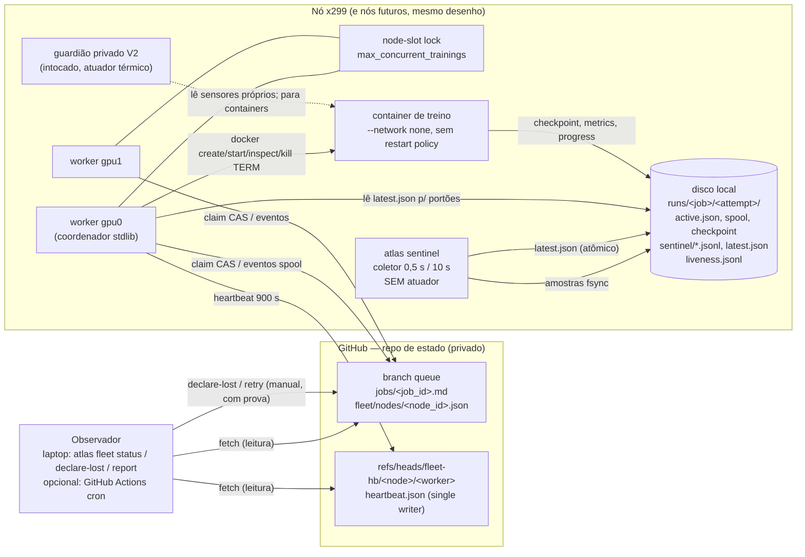
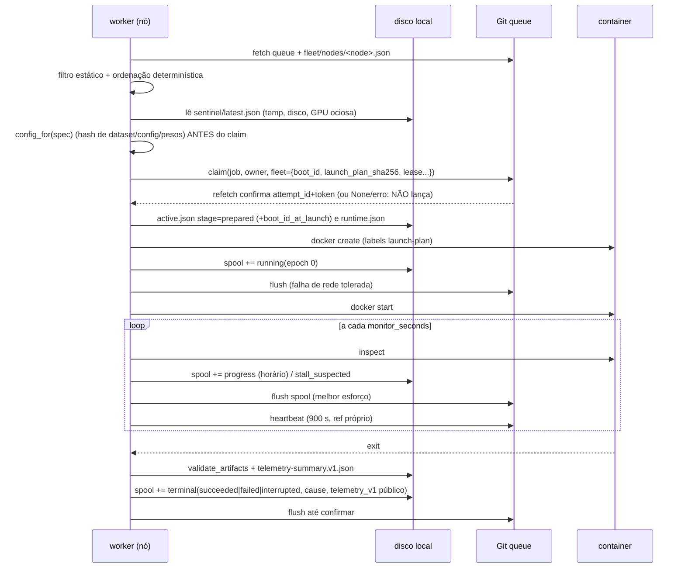
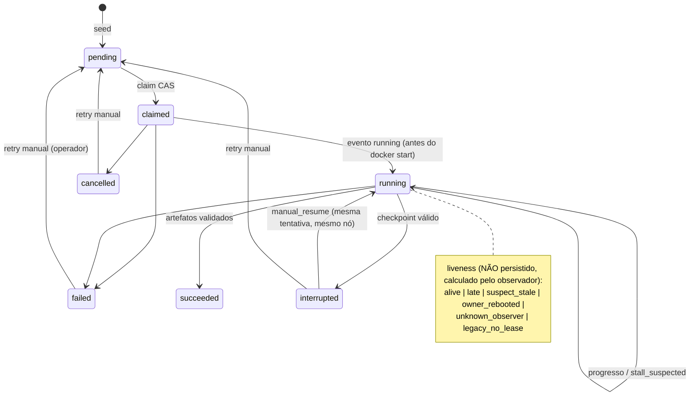

# AugmentAtlas fleet protocol — especificação v1 (proposta)

Status: **proposta de arquitetura, 2026-10-19**. Branch `feature/fleet-20261019`, base `b7a47f5`.
Este documento não implementa nada e não autoriza execução em nenhum servidor. Ele define
contratos para que o AugmentAtlas passe de "um servidor" para uma **frota de N nós
heterogêneos**, sendo o x299 o primeiro nó. Tudo o que já existe (fila Git CAS, spool
durável, `reconcile_stopped_attempt`, `request_training_stop`, guardião privado V2) é
reaproveitado; as mudanças são aditivas.

Convenções: "DEVE/NÃO DEVE" são invariantes testáveis. Identificadores de código e
campos ficam em inglês. Exemplos com `…` são ilustrativos, não valores reais.

---

## 0. Resumo das decisões

| # | Decisão | Justificativa em uma linha |
|---|---|---|
| D1 | Envelope do registro continua `schema_version: 1` + marcador `augment-atlas-record-v1`; tudo novo é aditivo | Um único registro v2 faria `list_jobs()` de workers antigos falhar para a fila inteira. |
| D2 | Requisitos do job em `spec.requirements` (imutável, fora da identidade) | Não muda nenhum `job_id` existente e reaproveita a regra "spec imutável". |
| D3 | Heartbeat em ref separado por worker (`refs/heads/fleet-hb/<node_id>/<worker>`), não no `.md` | Single-writer não disputa CAS com a fila e não engorda o `history` dos jobs. |
| D4 | Lease expirado gera `suspect_stale` **derivado** (só leitura); nunca roubo nem retry | Regra existente: nenhum timeout reatribui trabalho; o checkpoint mora no disco do nó. |
| D5 | Reboot detectado no restart do worker bloqueia a tentativa até `reconcile` deliberado | Hoje o worker classificaria a tentativa como `failed` sozinho, descartando um checkpoint válido. |
| D6 | Coletor de telemetria em processo próprio, sem atuador; o guardião V2 fica intocado | A proteção térmica não pode depender de Git, e o V2 só muda com revisão independente nova. |
| D7 | Escolha de job: filtro estático determinístico + portões ao vivo + CAS existente | Não precisa de escalonador central (sem servidor, sem SPOF) com N ≤ ~5 nós. |
| D8 | `node_profile.json` sem segredos e sem caminhos; os caminhos ficam em `worker.json` (privado) | Assim o perfil pode ser publicado como cartão do nó e ter hash. |
| D9 | Telemetria de treino v1 derivada dos artefatos existentes (`metrics.json`, `progress.json`, `docker inspect`) | Mudar `train.py` muda `code_commit` e, portanto, a identidade de todos os jobs. |
| D10 | Energia com taxonomia explícita: `measured_counter`, `measured_integrated`, `estimated_model`, `unavailable` | Impede somar medição com estimativa e impede chamar isso de "energia da tomada". |

ADRs detalhados na seção 10.

---

## 1. Stack e alternativas descartadas

| Camada | Escolha | Por quê | Descartado (e por quê) |
|---|---|---|---|
| Coordenação | Git puro (ramo `queue`), CAS por push fast-forward, já testado | Funciona atrás de NAT, sem servidor, com auditoria grátis | Redis/Postgres/Celery: exige servidor exposto e SPOF, e o time é de uma pessoa |
| Host | Python 3.11 stdlib | Invariante atual do projeto, testes rodam no Windows do Eduardo | `psutil`/`pynvml`: dependência no host; o ganho (contador NVML de energia) não existe em Maxwell |
| GPU | `nvidia-smi` em modo streaming (`-lms 500`) | Um único processo de longa duração em vez de fork a cada 0,5 s | DCGM/`dcgm-exporter`: serviço com privilégio e suporte fraco para GPUs antigas |
| Métricas | JSON Lines local + sumário JSON + CSV comparável | Arquivos simples, auditáveis e versionados | Prometheus/node_exporter/Grafana: mais serviços, portas e manutenção |
| Observador | CLI `atlas fleet status` (laptop) e, opcionalmente, cron do GitHub Actions | Sem servidor próprio; o Actions só lê e abre issue | Serviço de monitoramento 24/7: custo e superfície de ataque |

---

## 2. Arquitetura

### 2.1 Componentes e fluxo de dados



Fronteira com o guardião V2: **nenhum import, nenhuma escrita em arquivos dele**. O
sentinel e o V2 leem sensores de forma independente. Se uma revisão futura aprovar,
o V2 poderá *ler* `sentinel/latest.json` (contrato na seção 5.6), mas isso não é exigido.

### 2.2 Sequência de claim → execução → término



### 2.3 Estados do job e camada de liveness (derivada)



---

## 3. Contrato do job `.md` (fila durável)

### 3.1 O que existe hoje (`queue.py`, `schema.py`) — mantido

Arquivo `jobs/<job_id>.md` no ramo `queue`:

~~~text
# Job <job_id>

State: **<state>** | phase: <phase> | fold: <n> | train seed: <n> | arm: <arm>

Attempt: <attempt_id> | owner: <owner dict> | last observation UTC: <utc> | sequence: <seq>

Epoch: <e>/<total> | progress observed UTC: <utc>        (só se houver progresso)

<!-- augment-atlas-record-v1 -->
```json
{ registro canônico, sort_keys, ensure_ascii, sem NaN }
```
~~~

O JSON é a autoridade; o resumo é só para humanos. Registro atual:

| Campo | Tipo | Regra atual |
|---|---|---|
| `schema_version` | int = 1 | `validate_record` rejeita qualquer outro valor |
| `job_id` | hex64 | `sha256(canonical_json(10 campos de identidade))` |
| `spec` | objeto | imutável; contém a identidade + `config`, `config_sha256`, `dependencies`, `compatibility` |
| `state` | enum | `pending, claimed, running, succeeded, failed, cancelled, interrupted` |
| `version` = `seq` | int | `len(history)`; CAS: `update` exige `expected_version` exato |
| `attempt_id`, `token` | hex32 / null | null somente em `pending`; token é guarda de concorrência pública, não credencial |
| `owner` | objeto / null | hoje é `{server, gpu, gpu_uuid}` |
| `history[]` | lista | eventos `claim`, `update` (com `event_id`, `payload_hash`), `manual_retry` (com `recovery_id`) |

Mapeamento dos nomes pedidos para os existentes (**os nomes no JSON não mudam**):
`queued` = `pending`; `claimed`, `running`, `succeeded`, `failed` e `interrupted` são os
mesmos; `cancelled` continua existindo. O par "estado vN" (por exemplo `running v5`,
`interrupted v7`) é o par `(state, version)` usado como CAS em `update`.

Identidade (inalterada): `protocol_version, dataset, dataset_version, split_hash,
recipe_hash, phase, fold, train_seed, arm, code_commit`. `config_sha256`, a imagem e os
pesos **não** entram no `job_id`. Eles são campos imutáveis do spec e são verificados
antes do claim.

### 3.2 O que muda (aditivo, retrocompatível nos dois sentidos)

**(a) `spec.requirements`**: opcional, obrigatório para jobs semeados pela CLI ≥ fleet-v1.

```json
"requirements": {
  "schema": "atlas.requirements.v1",
  "gpu_required": true,
  "min_vram_mib": 11000,
  "min_compute_capability": [5, 2],
  "hardware_class": "gm200-12g",
  "allowed_nodes": null,
  "image_id": "sha256:<64hex do docker image inspect .Id>",
  "image_ref": "ghcr.io/OWNER/augment-atlas@sha256:<manifest digest>",
  "dataset": {"id": "inbreast-pilot-endurance",
              "version": "inbreast-existing-classification-integrity-20261016",
              "manifest_sha256": "90b7e97a…"},
  "weights_sha256": "11ad3fa6…",
  "min_free_disk_bytes": 5368709120,
  "container": {"cpus": 2, "memory_bytes": 4294967296},
  "expected_epoch_seconds_max": 1800
}
```

Regras:
- `image_id` é **obrigatório** quando `requirements` existe, porque é o hash do config da imagem, estável entre hosts para a mesma imagem. `image_ref` só serve para buscar a imagem.
- `hardware_class: null` significa "qualquer classe compatível". `allowed_nodes: null` significa todos.
- A CLI de seed DEVE preencher também `compatibility.image_id` e `compatibility.min_memory_mb`. Assim, um coordenador antigo, que só lê `compatibility`, ainda aplica imagem e VRAM.
- `schema` desconhecido (por exemplo `atlas.requirements.v2`) → o nó **não reivindica** e registra `skip_reason=unsupported_requirements_schema`. Isso é compatibilidade para a frente.
- **Jobs antigos** (sem `requirements`) recebem requisitos derivados `legacy`: `min_vram_mib = compatibility.min_memory_mb`, `image_id = compatibility.image_id` ou a imagem configurada no nó (comportamento atual), dataset igual a `spec.dataset` contido em `settings.datasets`, `gpu_required = true`. Eles seguem legíveis e executáveis exatamente como hoje.

**(b) `spec.scheduling`**: opcional e imutável: `{"priority": 0, "order": 120}`. Default `priority=0`, `order=null`.

**(c) `owner`**: chaves adicionais. `server` continua presente e igual a `node_id`, porque `reconcile_stopped_attempt` compara `owner.server` com `settings.server`.

```json
"owner": {"server": "x299", "node_id": "x299", "worker": "gpu0",
          "gpu": "0", "gpu_uuid": "GPU-…"}
```

**(d) Evento `claim`**: ganha um bloco `fleet`. `GitQueue.claim(job_id, owner, fleet=None)`
continua compatível com a assinatura atual. O bloco passa por `canonical_json` e não pode
usar chaves reservadas.

```json
{"kind": "claim", "state": "claimed", "attempt_id": "…", "token": "…", "owner": {…},
 "fleet": {
   "protocol": "atlas.fleet.v1",
   "node_profile_sha256": "…",
   "coordinator_commit": "…40hex",
   "boot_id": "6f1c…",
   "image_id": "sha256:…",
   "launch_plan_sha256": "…",
   "requirements_sha256": "…",
   "lease_seconds": 3600,
   "heartbeat_ref": "refs/heads/fleet-hb/x299/gpu0",
   "gate": {"observed_at_utc": "2026-10-19T12:00:00Z", "gpu_temp_c": 41,
            "cpu_pkg_temp_c": 38, "free_disk_bytes": 43892981760, "gpu_idle": true}
 }}
```

`launch_plan_sha256` = `digest(canonical{image_id, gpu_uuid, code_commit, config,
config_sha256, cpus, memory_bytes, shm_bytes, network:"none", cap_drop:"ALL",
mounts:[nomes lógicos code/data/output/torch-cache], resume:false})`. Os caminhos
locais **não** entram no hash. O mesmo valor vai no label
`org.augment-atlas.launch-plan` do container, e `reconcile` o confere.

Regras do `claim` com `fleet{}` (F5, esclarecimento):
- `fleet=None` grava exatamente o evento e os bytes de antes (sem a chave `fleet`).
- O bloco passa por `fleet_schema.validate_claim_fleet`. Exige-se também `owner.node_id` e
  `owner.worker`, `owner.server == owner.node_id` e
  `heartbeat_ref == refs/heads/fleet-hb/<owner.node_id>/<owner.worker>`. Isso é checado antes
  de qualquer I/O Git; uma falha gera `ValueError` e nada é escrito.
- `requirements_sha256 = digest(fleet.job_requirements(spec))`: o `spec.requirements`
  publicado ou, para job legado, `derive_legacy(spec)`. A comparação é feita contra o registro
  buscado, antes do commit. Divergência gera `ValueError` e nada é escrito.
- O bloco vai no mesmo evento `claim` (mesmo commit/CAS, `attempt_id`/`token`). A posse
  só vale depois do refetch, como hoje.

**(e) Eventos `update`**: campos novos dentro do evento, sem chave reservada.

| Momento | `state` | Campos (além de `event_id`, `observed_at_utc`) |
|---|---|---|
| Antes do `docker start` | `running` | `epoch: 0`, `launch_plan_sha256` |
| Progresso horário (existente) | `running` | `epoch`, `epochs`, `samples_processed` |
| Estagnação | `running` | `stall_suspected: true`, `stall_seconds`, `gpu_util_pct_mean`, `progress_age_s` |
| Sucesso | `succeeded` | (existente) `completed_sha256`, `artifact_count`, `epoch`, `epochs`, `samples_processed`; novo: `exit_code: 0`, `telemetry_v1` (público, seção 5.5) |
| Falha | `failed` | `exit_code`, `exit_signal` (por exemplo 11 se o exit for 139), `cause`, `oom_killed`, `validation_error?`, `training_failed?`, `telemetry_v1?` |
| Interrupção | `interrupted` | `exit_code`, `cause`, `checkpoint {sha256, size_bytes, epoch}`, `telemetry_v1?` |
| Reconciliação | qualquer terminal | `reconciliation: true`, `reason`, `evidence {…}` (seção 4.5) |

Enum `cause` v1:
- `interrupted`: `operator_stop`, `thermal_preventive`, `external_stop` (parada não iniciada pelo worker, por exemplo pelo V2), `deadline`, `disk_reserve`, `host_reboot`.
- `failed`: `nonzero_exit`, `signal` (com `exit_signal`), `oom_killed`, `training_error` (`failed.json`), `artifact_invalid`, `checkpoint_invalid`, `launch_error`, `host_reboot_checkpoint_invalid`, `node_lost`.

Exit 139 (o segfault observado) → `failed`, `cause: signal`, `exit_signal: 11`. O log do
container fica privado e não há retry.

**(f) Resumo Markdown**: duas linhas novas, só para humanos.

```text
Node: x299/gpu0 | GPU uuid: GPU-1a2b… | image: sha256:3f9c… | class: gm200-12g
Lease: 3600 s via fleet-hb/x299/gpu0 | requires: VRAM>=11000 MiB, dataset inbreast-…@90b7e97a
```

Liveness **não** aparece no `.md`, porque é derivada e não persistida (ADR-3).

**(g) Novos arquivos fora de `jobs/`**: `fleet/nodes/<node_id>.json` (cartão do nó,
seção 6.3). `_records()` só lista `jobs/` e `_commit()` preserva a árvore. Por isso,
código antigo ignora esses arquivos sem erro.

### 3.3 O que o nó escreve e quando

| Fase | Local (durável, antes) | Remoto (Git) | Invariante |
|---|---|---|---|
| Antes do claim | nada | nada | `config_for` + portões passaram; uma falha aqui não toca a fila |
| Claim | nada antes; depois da confirmação, `active.json` (`stage=prepared`, `boot_id_at_launch`, `btime_at_launch`, `launch_plan_sha256`) e `runtime.json` | evento `claim` com `fleet{}` | **posse confirmada por refetch ANTES de criar o container**; sem confirmação não há treino (comportamento atual) |
| Create/start | `stage=launched`, spool `running(epoch 0)` | flush do spool (falha de rede tolerada) | o container só nasce de um registro confirmado com `owner.node_id == este nó` |
| Execução | spool de progresso; `liveness.jsonl` a cada 30 s | progresso horário; heartbeat a cada 900 s no ref próprio | nenhum parâmetro de treino vem de `worker.json`; tudo vem de `spec` + `config_sha256` |
| Término | `telemetry-summary.v1.json`, spool terminal | evento terminal até confirmar | o terminal é decidido e gravado no spool antes de qualquer I/O Git (padrão atual de `reconcile`) |

**Invariante "o nó só executa o que está no `.md`"**, verificada em testes:
1. todo container `atlas-*` corresponde a um `active.json` cujo `record` tem `owner.node_id == settings.server` e `attempt_id`/`token` confirmados remotamente;
2. o comando do container é função pura de `(spec, node_profile.limits)`;
3. `label launch-plan == fleet.launch_plan_sha256` do claim;
4. **nunca** `--restart` no `docker create`, porque uma restart policy seria um retry automático de treino.

---

## 4. Liveness, lease e nó travado

### 4.1 Fatos que o desenho precisa respeitar

- Um nó travado (18/10: cerca de 14,5 h sem log, GPU0 a 83 °C/181 W, abaixo da preventiva de 89 °C) **não escreve nada**: nem terminal, nem telemetria, nem heartbeat. O `.md` fica em `running` indefinidamente.
- Do ponto de vista remoto, "nó travado" e "Git do nó indisponível" são **indistinguíveis enquanto duram**. A distinção só vem de evidência local, depois que o nó volta.
- O checkpoint mora no disco do nó. Outro nó não consegue retomar a tentativa.

### 4.2 Heartbeat em ref separado (ADR-2)

Ref: `refs/heads/fleet-hb/<node_id>/<worker>`, com um arquivo `heartbeat.json`. Cada
worker é o **único escritor** do seu ref. Cada heartbeat é um commit filho do anterior,
publicado com push fast-forward comum (sem force push). Usa um checkout próprio
(`<queue_checkout>-hb`), porque `FETCH_HEAD` não pode ser compartilhado entre
processos (regra de `queue.md`).

```json
{
  "schema": "atlas.heartbeat.v1",
  "node_id": "x299", "worker": "gpu0", "seq": 1842,
  "observed_at_utc": "2026-10-19T12:15:00Z",
  "boot_id": "6f1c…", "btime": 1760860800, "uptime_s": 86400.2,
  "ntp_synchronized": true,
  "coordinator_commit": "…", "node_profile_sha256": "…",
  "status": "running",
  "active": [{"job_id": "…", "attempt_id": "…", "container": "running", "epoch": 3,
              "progress_age_s": 410}],
  "sentinel_last_sample_age_s": 0.6,
  "spool_pending_events": 0,
  "host_loss_detected": [],
  "gap_report": null
}
```

`status` ∈ `idle | running | draining | blocked_host_loss | blocked_manual`.

Custo: com `heartbeat_seconds = 900`, são 96 commits por dia por worker, ou 192 por dia
no x299 com 2 workers. Cada commit tem cerca de 1 KB, o que dá alguns MB por ano. Não há
disputa com o ramo `queue`. Com 60 s seriam 1.440 por dia por worker, o que não se
justifica para detectar uma trava de horas. O workflow do Actions (se adotado) NÃO pode
ter gatilho em push para `fleet-hb/**`.

O heartbeat roda no loop do worker, que já itera a cada 2 s. O push do heartbeat tem
timeout de 60 s, como todas as operações Git. Ele é melhor esforço: uma falha vai para o
`liveness.jsonl` local e não para o treino.

**Journal local de liveness**: `<state>/liveness/<node>-<worker>.jsonl`, uma linha a
cada 30 s (`utc`, `mono_s`, `boot_id`, `status`, `git_ok_last`), com fsync. É a prova
local usada para distinguir as causas de uma lacuna.

### 4.3 Lease

O lease é declarado no claim (`fleet.lease_seconds`, default `4 × heartbeat_seconds =
3600`) e avaliado pelo observador com uma função pura, sem escrita:

```text
liveness(record, heartbeats_by_ref, all_worker_heartbeats, now_utc, observer_fetch_ok) -> {state, age_s, evidence}

se record.state ∉ {claimed, running}            -> n/a
se claim sem bloco fleet                         -> legacy_no_lease   (mostra só a idade do último evento)
hb = heartbeats[fleet.heartbeat_ref]
se observer_fetch_ok == false                    -> unknown_observer
se hb.boot_id != fleet.boot_id                   -> owner_rebooted    (o nó voltou; a tentativa perdeu o host)
age = now_utc - hb.observed_at_utc
se age <= lease                                  -> alive  (late se age > 2*heartbeat)
se >= 50% dos outros workers também vencidos     -> unknown_observer  (provável GitHub/observador, não o nó)
senão                                            -> suspect_stale
```

O relógio vem do UTC do nó, com NTP obrigatório (`ntp_synchronized` no heartbeat, lido
sem privilégio via `timedatectl show -p NTPSynchronized`). Tolerância de skew: 120 s.
Se `ntp_synchronized=false`, o estado sai como `late` com `evidence.clock_untrusted=true`.

### 4.4 O que acontece quando o lease expira

**Nada automático.** Não há roubo, não há retry e o job não volta para `pending`.
`suspect_stale` só aparece em `atlas fleet status` e, opcionalmente, em uma issue aberta
pelo cron do Actions. O job continua `running` e pertencendo ao nó original.

| Situação | Evidência remota | Evidência local (quando o nó volta) | Classificação |
|---|---|---|---|
| Git do nó indisponível | heartbeat vencido; outros nós ok | `liveness.jsonl` contínuo, mesmo `boot_id`, spool com eventos pendentes | `git_outage`: o spool drena sozinho, sem ação |
| Coordenador morreu, container vivo | heartbeat vencido | `boot_id` igual, lacuna no `liveness.jsonl`, `sentinel` contínuo, container `running` | `coordinator_down`: reiniciar o worker reanexa (comportamento atual) |
| Trava dura e reboot manual (18/10) | heartbeat vencido; depois `owner_rebooted` | `boot_id` novo, `container.StartedAt < btime` atual, lacunas em sentinel e liveness | `host_reboot`: tentativa bloqueada até `reconcile` (4.5) |
| Congelamento sem reboot | heartbeat vencido e depois volta | `boot_id` igual, lacuna simultânea em todos os logs locais | `host_freeze`: só observação; o treino segue se o container estiver vivo |
| Nó perdido de vez | vencido indefinidamente | inacessível | `node_lost` via `declare-lost` (4.6) |
| GitHub/observador fora | todos vencidos | — | `unknown_observer` |

Ao voltar, o worker publica um único heartbeat com `gap_report`:

```json
"gap_report": {"gap_start_utc": "…", "gap_end_utc": "…",
               "classification": "host_reboot",
               "boot_id_changed": true, "liveness_journal_continuous": false,
               "sentinel_continuous": false, "spool_pending_events": 0,
               "last_sentinel_sample_before_gap": {"utc": "…", "gpu0_temp_c": 83, "gpu0_power_w": 181}}
```

### 4.5 Reboot detectado no restart (ADR-4): muda o worker

Hoje, depois de um reboot, o worker encontra `active.json` com o container `exited`. O
Docker costuma registrar o ExitCode 255 após a perda do host (**confirmar no x299 com o
container de 18/10, se ele ainda existir**). O loop então publicaria `failed`
(`nonzero exit`) automaticamente, descartando um checkpoint possivelmente válido.

Regra nova:
1. Ao iniciar, se existe `active.json` e (`boot_id_now != active.boot_id_at_launch`) ou (`container.State.StartedAt < btime_now`), o worker grava `stage=host-loss-detected`, **não publica nada no job**, publica um heartbeat com `status=blocked_host_loss` e `host_loss_detected=[attempt]`, e sai com código não zero. A comparação com `btime` cobre os journals legados sem `boot_id`.
2. O operador roda `atlas fleet reconcile --active <path> --reason "<texto>"` no próprio nó. A função estende `reconcile_stopped_attempt` (mesmas verificações de identidade do container, owner, spool e versão) com a regra:
   - `host_reboot` provado + container parado + `_stopped_checkpoint` válido + sem `failed.json` + `OOMKilled=false` → `interrupted`, `cause=host_reboot`;
   - `host_reboot` provado + checkpoint inválido → `failed`, `cause=host_reboot_checkpoint_invalid`;
   - fora isso, a lógica atual (inalterada).

   `evidence = {kind:"node_reported_reboot", boot_id_at_launch, boot_id_now, btime_now, container_started_at, container_finished_at, container_exit_code, last_liveness_utc, last_sentinel_sample_utc}`.
3. Depois disso o operador decide: `--resume` (caminho existente `interrupted → running` com `manual_resume`, mesmo nó, mesmo attempt) ou `retry` (tentativa nova do zero, em qualquer nó).

### 4.6 `declare-lost` (nó que não volta)

`atlas fleet declare-lost --job <id> --node <node_id> --evidence-kind <k> --reason "<texto>"`,
executado do laptop com acesso de escrita:
- pré-condições: `liveness == suspect_stale` há pelo menos `2 × lease_seconds`, `evidence-kind ∈ {operator_confirmed_power_off, node_storage_unrecoverable}` e confirmação digitada do `job_id`. `lease_expired_only` é **rejeitado**;
- publica `failed`, `cause=node_lost`, `reconciliation=true`, usando o `attempt_id`/`token` do registro (o token é público por desenho) e o `expected_version` exato;
- o retry continua separado e manual (`retry`), e gera uma tentativa nova do zero. Não existe transferência de checkpoint entre nós no v1.

**Cerca contra ressurreição**: se o nó "perdido" estava só particionado e volta com o
container vivo, o próximo `update` dele recebe `StaleAttempt` (depois do retry) ou
`InvalidTransition` (terminal). Os dois são `QueueConflict`, e o worker atual já reage com
`request_training_stop`. O worker então grava `stage=orphaned_after_declared_lost` e não
publica mais nada. Há teste explícito para isso.

---

## 5. Telemetria v1

### 5.1 Processos e fronteiras

| Processo | Cadência | Escreve | Atua? | Depende de Git? |
|---|---|---|---|---|
| `atlas sentinel run` (novo, 1 por nó) | rápida 0,5 s; lenta 10 s | `sentinel/<boot_id>/fast-*.jsonl`, `slow-*.jsonl`, `events.jsonl`, `latest.json` | **Não** | Não |
| guardião privado V2 (existente) | 0,5 s (próprio) | os seus arquivos privados | Sim (para containers) | Não |
| worker | 2 s | lê `latest.json`; escreve o sumário por job e os eventos | só `request_training_stop` (como hoje) | Sim (melhor esforço) |

- O sentinel é um processo separado, com `nice` positivo e sem threads de Git. Uma falha de sensor nunca o derruba: cada leitor roda isolado e qualquer exceção vira `null` + `reason=collector_error`.
- O `telemetry.py` atual (amostra de 30 s por tentativa) **permanece** como fallback quando o sentinel está ausente. Isso não muda nenhum comportamento existente.
- `nvidia-smi` em modo streaming: `nvidia-smi --query-gpu=<campos> --format=csv,noheader,nounits -lms 500`, como um processo filho de longa duração. Um watchdog reinicia o filho se ficar mais de 3 s sem linha, com backoff de 1, 2, 4… até 30 s, e emite `event: gpu_stream_gap`.
- fsync: o arquivo rápido recebe fsync no máximo a cada 5 s (perda máxima de 5 s antes de uma trava). `latest.json` usa substituição atômica a cada amostra rápida.
- Rotação horária. Segmentos fechados viram `.gz`. Orçamento estimado: ≤ 100 MB/dia/nó sem compressão. O sentinel entra na conta do portão de reserva de disco.
- O intervalo real vem sempre de `time.monotonic()`. O UTC é só rótulo; um salto de NTP não distorce as integrais.

### 5.2 Registros JSONL (todos com `schema`, `node_id`, `boot_id`, `seq`, `utc`, `mono_s`)

Regras comuns:
- valor ausente = `null`, e o caminho do campo aparece em `null_reasons` com um código do enum abaixo;
- nunca `0` no lugar de ausente, nunca `NaN`/`Inf` (o `canonical_json` atual rejeita `NaN`);
- unidades no nome do campo (`_c`, `_w`, `_mib`, `_mhz`, `_pct`, `_bytes`, `_uj`, `_s`).

Enum `reason`: `not_exposed`, `permission_denied`, `tool_absent`, `tool_timeout`,
`parse_error`, `not_supported_by_device`, `disabled_by_config`, `stale`,
`collector_error`, `first_sample`.

**Rápido (0,5 s)**:

```json
{"schema": "atlas.telemetry.v1", "type": "fast", "node_id": "x299", "boot_id": "6f1c…",
 "seq": 120443, "utc": "2026-10-19T12:00:00.512Z", "mono_s": 86400.512, "dt_s": 0.501,
 "gpus": [{"index": 0, "temp_c": 83, "power_w": 181.2, "util_pct": 99, "mem_used_mib": 10850,
           "sm_mhz": 1189, "mem_mhz": 3505, "fan_pct": 61, "pstate": "P2"},
          {"index": 1, "temp_c": 34, "power_w": 15.1, "util_pct": 0, "mem_used_mib": 2,
           "sm_mhz": 135, "mem_mhz": 405, "fan_pct": 22, "pstate": "P8"}],
 "cpu_pkg": [{"package": 0, "temp_c": 62.0}],
 "null_reasons": {},
 "src": {"gpu": "nvidia-smi-stream", "cpu_pkg": "hwmon:coretemp"}}
```

**Lento (10 s)**:

```json
{"schema": "atlas.telemetry.v1", "type": "slow", "node_id": "x299", "boot_id": "6f1c…",
 "seq": 6022, "utc": "…", "mono_s": 86410.0, "dt_s": 10.002,
 "uptime_s": 86410.0, "btime": 1760860800,
 "cpu": {"util_pct": 14.2, "load_1_5_15": [2.1, 2.0, 1.9], "freq_mhz": {"min": 1200, "mean": 3301, "max": 4000},
         "core_temps_c": [{"core": 0, "temp_c": 55}, "…"],
         "pkg_temp_limits_c": {"high": 85, "crit": 95}},
 "memory": {"ram_total_bytes": 33…, "ram_available_bytes": 21…, "swap_total_bytes": 2…, "swap_free_bytes": 2…},
 "disks": [{"key": "runs", "total_bytes": 9…, "free_bytes": 43…, "reserve_bytes": 21474836480}],
 "rapl": [{"domain": "package-0", "zone": "intel-rapl:0", "energy_uj": null, "max_range_uj": 262143328850, "delta_uj": null},
          {"domain": "dram", "zone": "intel-rapl:0:0", "energy_uj": null, "max_range_uj": 65712999613, "delta_uj": null}],
 "fans": null,
 "gpus": [{"index": 0, "power_limit_w": 250, "clock_event_reasons": ["sw_power_cap"], "ecc_errors": null,
           "pcie_gen": 3, "pcie_width": 16, "compute_apps": 1}],
 "thermal_zones": [{"type": "acpitz", "temp_c": 27.8}],
 "crash": {"var_crash_count": 0, "var_crash_new": 0},
 "containers": [{"name": "atlas-…", "running": true}],
 "null_reasons": {"rapl[0].energy_uj": "permission_denied", "rapl[1].energy_uj": "permission_denied",
                  "fans": "not_exposed", "gpus[0].ecc_errors": "not_supported_by_device",
                  "kernel_xid": "permission_denied"},
 "src": {"cpu_temp": "hwmon:coretemp", "rapl": "sysfs:powercap", "gpu": "nvidia-smi-query"}}
```

**Eventos** (`type: "event"`): `collector_start`, `collector_stop`,
`reboot_detected` (`prev_boot_id`, `prev_last_sample_utc`, `gap_s`),
`sample_gap` (`gap_s` > 2 × cadência), `gpu_stream_gap`, `sensor_state_change`
(`field`, `from`, `to`), `rapl_wrap` (`domain`), `rapl_suspect_multi_wrap`,
`var_crash_new` (só nomes, **privado**) e `threshold_observed` (cruzamento observado;
não é ação).

Detecção de reboot: na partida, o sentinel lê o `state.json` da execução anterior
(`last boot_id`, `last utc`). Se o `boot_id` mudou, emite `reboot_detected` com a última
amostra fsync-ada antes da lacuna. É isso que daria o "estado no último instante" da trava
de 18/10.

Wraparound do RAPL: `delta = new - old` se `new >= old`; senão `(max_range_uj - old) + new`.
Se `dt_s × potência_máx_plausível > max_range_uj`, o sentinel emite
`rapl_suspect_multi_wrap` e descarta o delta. Isso só tem efeito quando `energy_uj` é
legível.

Integração da energia de GPU: trapézio sobre `power_w` com Δt monotônico. Intervalos com
Δt > 2 s **não são integrados**; a fração coberta vai para `coverage_fraction`.

### 5.3 Telemetria de treino por job (derivada, sem mudar `train.py`)

`runs/<job>/<attempt>/training-timeline.v1.json` (privado):

| Campo | Fonte | Observação |
|---|---|---|
| `epochs[].{epoch, utc, train_loss, selection.loss, selection.accuracy, learning_rate, samples_processed}` | `metrics.json` | as métricas de modelo são **privadas** (política atual) |
| `epochs[].duration_s` | diferença entre `utc` consecutivos; época 1 = `metrics[0].utc − container.StartedAt` (`includes_startup: true`) | épocas que atravessam um resume ficam marcadas `spans_resume: true` |
| `epochs[].throughput_img_s` | Δ`samples_processed` / `duration_s` | |
| `batch_time_s` | — | `null`, `reason: not_instrumented` no v1 |
| `vram_used_mib_max` | máximo de `gpus[i].mem_used_mib` (sentinel) na janela do job | `scope: gpu_level` (vale porque o uso da GPU é serial) |
| `environment` | `environment.json` + `nvidia-smi` | `torch`, `torchvision`, `cuda`, `driver`, `gpu.name`, `compute_capability`, `opencv` |
| `identity` | spec + artefatos | `code_commit`, `image_id`, `config_sha256`, `split_hash`, `recipe_hash`, `weights_sha256`, `train_seed`, `split_seed`, `launch_plan_sha256` |

A instrumentação por batch (`timing.jsonl` no trainer) fica para uma revisão futura do
`train.py`, sabendo que isso cria um `code_commit` novo.

### 5.4 Custo verde

`runs/<job>/<attempt>/telemetry-summary.v1.json` (privado, completo):

```json
{"schema": "atlas.job-telemetry-summary.v1", "node_id": "x299", "hardware_class": "gm200-12g",
 "job_id": "…", "attempt_id": "…", "window": {"start_utc": "…", "end_utc": "…", "duration_s": 5321.4},
 "coverage": {"fast_fraction": 0.998, "max_gap_s": 1.4, "reboot_detected": false},
 "thermal": {"gpu_temp_max_c": 83, "gpu_temp_p95_c": 81, "cpu_pkg_temp_max_c": 66},
 "power": {"gpu_power_mean_w": 176.3},
 "energy": {
   "gpu_kwh":       {"value": 0.2607, "status": "measured_integrated", "source": "nvidia-smi power.draw @0.5s", "gpu_index": 0},
   "cpu_pkg_kwh":   {"value": null, "status": "unavailable", "reason": "permission_denied"},
   "dram_kwh":      {"value": null, "status": "unavailable", "reason": "permission_denied"},
   "cpu_kwh_estimated": {"value": null, "status": "estimated_model", "method": null, "reason": "disabled_by_config"}
 },
 "boundary": {"measured": ["gpu_board"], "estimated": [], "unavailable": ["cpu_package", "dram"],
              "excluded_always": ["psu_losses", "motherboard", "disks", "fans", "network", "cooling"],
              "note": "Not wall-plug energy."},
 "co2": {"g": 0.0, "boundary": ["gpu_board"], "basis": "measured_only",
         "grid_factor_g_per_kwh": null, "factor_source_id": null, "reason": "grid_factor_missing"},
 "attribution": {"gpu": "exclusive_device", "cpu_pkg": "host_shared_serial_node"}}
```

Regras:
- `co2.g = Σ kWh(status ∈ {measured_counter, measured_integrated}) × grid_factor_g_per_kwh`. As estimativas aparecem em um campo separado (`co2_estimated_g`) e **nunca** são somadas ao medido. Sem fator, `g = null` com `reason`.
- `measured_integrated` (potência amostrada e integrada) ≠ `measured_counter` (contador de energia do hardware). Essa diferença fica no rótulo.
- `cpu_kwh_estimated` vem desligado por padrão. Se for ligado, o método fica nomeado e versionado (por exemplo `cpu_tdp_util_linear_v1`, com TDP declarado no perfil) e sempre rotulado `estimated_model`.
- Linha de base ociosa da GPU (30 s antes do start) vai para `power.gpu_idle_baseline_w`, apenas informativa. O valor principal é bruto.

### 5.5 Público × privado

| Dado | Onde | Público? |
|---|---|---|
| amostras rápidas/lentas, eventos, nomes em `/var/crash`, lista de containers | `runs/sentinel/…` | **não** |
| métricas de modelo por época (loss/acurácia) | `training-timeline.v1.json` | **não** (política atual) |
| sumário completo | `telemetry-summary.v1.json` | não |
| `telemetry_v1` no evento terminal | `.md` | **sim**, com lista branca fixa: `schema, node_id, hardware_class, duration_s, coverage_fraction, max_gap_s, gpu_temp_max_c, gpu_temp_p95_c, cpu_pkg_temp_max_c, gpu_power_mean_w, energy.{gpu_kwh,cpu_pkg_kwh,dram_kwh}.{value,status}, co2.{g,boundary,grid_factor_g_per_kwh,factor_source_id}, throughput_img_s_mean, epochs_completed, reboot_detected` |
| heartbeat | ref `fleet-hb/*` | sim (sem caminhos, sem hostname/IP) |
| tabela comparável | gerada localmente (`atlas fleet report`) | publicar é decisão do Eduardo |

Proibido em qualquer artefato público: IDs/nomes de paciente, nomes de arquivo de
imagem, caminhos locais, hostnames/IPs, URLs de remoto, tokens/chaves e conteúdo de
crash. Há teste que varre os campos públicos (seção 7).

### 5.6 Contrato `sentinel/latest.json` (fronteira com worker e, no futuro, V2)

```json
{"schema": "atlas.sentinel-latest.v1", "node_id": "x299", "boot_id": "…", "utc": "…", "mono_s": 86400.5,
 "gpus": [{"index": 0, "uuid": "GPU-…", "temp_c": 41, "util_pct": 0, "compute_apps": 0}],
 "cpu_pkg_max_temp_c": 38, "disks": [{"key": "runs", "free_bytes": 43…}],
 "null_reasons": {}}
```

Consumidor: idade = `now_mono − mono_s` (mesmo boot). Se a idade for maior que 5 s, o
dado é `stale` e o portão bloqueia o claim.

### 5.7 Tabela comparável entre nós (colunas fixas, `fleet-telemetry-v1.csv`)

`schema_version, node_id, hardware_class, gpu_name, gpu_vram_mib, driver, cuda_runtime,
torch, image_id12, code_commit12, job_id12, attempt_id12, dataset, dataset_version, arm,
fold, train_seed, phase, terminal_state, cause, exit_code, epochs_completed, duration_s,
samples_processed, throughput_img_s_mean, coverage_fraction, max_gap_s, reboot_detected,
gpu_temp_max_c, gpu_temp_p95_c, cpu_pkg_temp_max_c, gpu_power_mean_w, energy_gpu_kwh,
energy_gpu_status, energy_cpu_pkg_kwh, energy_cpu_pkg_status, energy_dram_kwh,
energy_dram_status, energy_cpu_kwh_estimated, estimation_method, measurement_boundary,
grid_factor_g_per_kwh, grid_factor_source_id, co2_g_measured, co2_g_estimated`

Valor ausente é célula vazia, e a coluna `*_status` correspondente explica o motivo. A
ordem das colunas é congelada pelo `schema_version` da tabela.

### 5.8 Cobertura do x299 hoje (fatos informados; confirmar com fixtures reais)

| Campo | x299 | Fonte / motivo |
|---|---|---|
| Temp. CPU por pacote e por núcleo | **sim** | `coretemp`: Package/Core, `high 85`, `crit 95` |
| `acpitz` | sim, classificado como zona ACPI, **não** CPU | hwmon/thermal |
| Uso de CPU, load, RAM/swap, disco | sim | `/proc`, `statvfs` |
| Frequência de CPU | provável | `scaling_cur_freq` costuma ser 0444; confirmar |
| Energia RAPL package/DRAM | **não** | `intel-rapl:0` e `intel-rapl:0:0` existem, mas `energy_uj` é 0400 root → `permission_denied` |
| Fans RPM/PWM (hwmon) | **não** | hwmon só tem `acpitz` e `coretemp` → `not_exposed` |
| Fan da GPU (%) | sim | `nvidia-smi fan.speed` |
| Temp., potência, uso, memória e clocks da GPU | sim | `nvidia-smi` |
| `power.limit` (só leitura) | sim | `nvidia-smi` |
| Razões de throttle/clock-event | provável | confirmar com `--help-query-gpu` (driver 580 usa `clocks_event_reasons.*`) |
| Contador de energia da GPU (NVML total energy) | **não** | só Volta+ → energia por integração (`measured_integrated`) |
| ECC | **não** | GTX TITAN X (Maxwell) não tem ECC → `not_supported_by_device` |
| Xid / log do kernel | **não** | sem grupo `adm`/`systemd-journal` → `permission_denied` |
| `boot_id`, `btime`, uptime | sim | `/proc/sys/kernel/random/boot_id`, `/proc/stat` |
| Novos arquivos em `/var/crash` | sim (listar nomes) | o conteúdo não é lido |

---

## 6. `node_profile.json`

### 6.1 Princípios

- O perfil fica no nó, em um arquivo privado mas **publicável**: sem segredos, sem caminhos, sem hostname/IP. Os caminhos continuam em `worker.json`, que mapeia chaves lógicas (`runs`, `data`, `torch_cache`) para diretórios.
- `profile_sha256 = digest(canonical_json(profile))`. O valor vai no claim e no heartbeat. O worker recusa claim se o cartão publicado (`fleet/nodes/<id>.json`) tiver outro hash, ou se `status != "active"`.
- O perfil é gerado por `atlas fleet profile probe`, que só lê e não usa privilégio. Em seguida o Eduardo revisa e preenche os limites e o fator de rede **à mão**: as políticas não são auto-detectadas.

### 6.2 Schema v1 (exemplo x299; `…` = preencher com a sonda)

```json
{
  "schema": "atlas.node-profile.v1",
  "node_id": "x299",
  "status": "active",
  "hardware_class": "gm200-12g",
  "hardware": {
    "cpu": {"model": "…lscpu Model name…", "sockets": 1, "cores": 10, "threads": 20, "tdp_w": null},
    "ram_bytes": 34359738368,
    "gpus": [
      {"index": 0, "name": "NVIDIA GeForce GTX TITAN X", "vram_mib": 12288, "compute_capability": [5, 2], "uuid": "GPU-…(opcional)"},
      {"index": 1, "name": "NVIDIA GeForce GTX TITAN X", "vram_mib": 12288, "compute_capability": [5, 2], "uuid": "GPU-…(opcional)"}
    ],
    "software": {"os": "Ubuntu …", "kernel": "6.8.…", "nvidia_driver": "580.…", "docker": "…", "nvidia_container_toolkit": "…"}
  },
  "storage": [
    {"key": "runs", "reserve_bytes": 21474836480},
    {"key": "data", "reserve_bytes": 0}
  ],
  "limits": {
    "max_concurrent_trainings": 1,
    "allowed_gpus": [0, 1],
    "container": {"cpus": 2, "memory_bytes": 4294967296, "shm_bytes": 268435456},
    "thermal": [
      {"sensor": "gpu.temp_c", "ceiling_c": 90, "preventive_c": 89, "claim_max_c": 75, "source": "nvidia-smi"},
      {"sensor": "cpu_pkg.temp_c", "ceiling_c": 90, "preventive_c": 85, "claim_max_c": 75, "source": "hwmon:coretemp"}
    ],
    "min_idle_seconds_between_jobs": 60,
    "training_retry": "never",
    "forbidden_host_changes": ["fan_control", "power_limit", "driver", "bios", "os_config"]
  },
  "guardian": {"kind": "private-v2", "required_for_claim": true, "review_ref": "…",
               "declared_thresholds": {"gpu_ceiling_c": 90, "gpu_preventive_c": 89, "cadence_s": 0.5}},
  "liveness": {"heartbeat_seconds": 900, "lease_seconds": 3600, "ntp_required": true},
  "datasets": [
    {"id": "inbreast-pilot-endurance", "version": "inbreast-existing-classification-integrity-20261016",
     "manifest_sha256": "90b7e97a…", "storage_key": "data",
     "validated_at_utc": "…", "validation": {"images_checked": 387, "image_hashes_verified": true, "tool_commit": "…"}},
    {"id": "synthetic-tiny", "version": "*", "manifest_sha256": null, "storage_key": null, "validation": {"synthetic": true}}
  ],
  "images": [{"image_id": "sha256:…", "validated_at_utc": "…",
              "probe": {"torch": "2.5.1", "cuda": "12.4", "capability": [5, 2], "forward_backward": true, "opencv": "4.12.0"}}],
  "weights": [{"file": "resnet50-11ad3fa6.pth", "sha256": "11ad3fa6…"}],
  "sensors": {
    "gpu.temp_c": "available", "gpu.power_w": "available", "gpu.fan_pct": "available",
    "gpu.clock_event_reasons": "unverified", "gpu.energy_counter": {"status": "unavailable", "reason": "not_supported_by_device"},
    "cpu_pkg.temp_c": "available", "cpu_core.temp_c": "available",
    "rapl.package": {"status": "unavailable", "reason": "permission_denied"},
    "rapl.dram": {"status": "unavailable", "reason": "permission_denied"},
    "hwmon.fan_rpm": {"status": "unavailable", "reason": "not_exposed"},
    "kernel_log": {"status": "unavailable", "reason": "permission_denied"},
    "nvidia_smi_fields": ["…saída de --help-query-gpu filtrada…"]
  },
  "grid": {"g_co2_per_kwh": null, "source": null, "region": null, "reference_period": null, "retrieved_on": null},
  "updated_at_utc": "2026-10-19T00:00:00Z"
}
```

Validação (`node_profile.validate`):
- `0 < preventive_c < ceiling_c` e `claim_max_c < preventive_c`;
- `allowed_gpus ⊆ índices de gpus`;
- `reserve_bytes ≥ 0`;
- `lease_seconds ≥ 2 × heartbeat_seconds`;
- `training_retry == "never"` (é o único valor aceito no v1);
- `grid.g_co2_per_kwh` é null ou número > 0 com `source` e `reference_period` presentes;
- nenhum valor de string parecido com caminho absoluto, URL com credencial, IP ou chave.

### 6.3 Cartão público `fleet/nodes/<node_id>.json`

É o perfil inteiro + `profile_sha256` + `registered_at_utc`. Opcionalmente os `uuid` das
GPUs podem ser removidos; hoje eles já aparecem em `owner` público. A escrita é feita por
`atlas fleet register`, via CAS no ramo `queue` (método genérico `put_document(path,
content, expected_blob)` no `GitQueue`), e só pelo operador.
`status ∈ {active, draining, retired}`. Com `draining`, o nó termina o job atual e não
reivindica outro.

---

## 7. Escolha de job por capacidade

### 7.1 Algoritmo (determinístico; a corrida é decidida pelo CAS existente)

```text
select_and_claim(records, profile, card, sentinel_latest, settings) -> record | None

0. pré-condições do nó (falha → não reivindica nada, registra blocked_reason):
   card.status == active e card.profile_sha256 == sha(profile)
   não existe active.json (nem stage host-loss-detected / orphaned)
   slot do nó adquirido (flock em locks/node-slot-<k>, k < max_concurrent_trainings)
   lock da GPU (gpu_lock existente)
   guardian armado (se required_for_claim; ver a pergunta P6)
   sentinel_latest com idade ≤ 5 s e mesmo boot_id
   portões ao vivo do NÓ: temp de cada sensor ≤ claim_max_c; free_bytes(runs) - reserve ≥ 0;
     GPU deste worker: compute_apps == 0 e util_pct < 10; ≥ min_idle_seconds desde o último job
1. candidatos = [r | r.state == pending e todas as dependências succeeded]
2. req = r.spec.requirements ou derive_legacy(r.spec)            # puro
3. filtro estático (puro, com motivo):
   schema suportado; phase == settings.phase; code_commit == checkout de treino;
   gpu_required → GPU deste worker ∈ allowed_gpus; vram ≥ min_vram_mib; cc ≥ min_cc;
   hardware_class null ou igual; allowed_nodes null ou contém node_id;
   image_id ∈ profile.images; dataset (id, version, manifest_sha256) ∈ profile.datasets;
   weights_sha256 ∈ profile.weights (se pretrained);
   container cpus/memory ≤ limits.container
4. portão por job: free_bytes(runs) - reserve ≥ req.min_free_disk_bytes
5. ordenar por (-priority, order nulls last, job_id)
6. para cada r na ordem:
     config_for(r.spec)                      # validação pesada existente (hash de dados/config/pesos), ANTES do claim
     rec = queue.claim(r.job_id, owner, fleet=claim_info(r, gate_snapshot))
     se rec: retorna rec                     # confirmado por refetch
   retorna None
```

- Determinismo: com o mesmo estado remoto, perfil e snapshot, a escolha é a mesma. Dois nós que escolhem o mesmo job disputam o CAS: um vence e o outro passa ao próximo candidato (`claim` devolve `None`). Isso é o que já está testado em `test_two_clones_race_exactly_one_confirmed_claim`.
- `config_for` pode ser caro (hash de 387 imagens). Por isso fica um cache local por `(config_sha256, manifest_sha256, mtime/size do manifesto)`, invalidado se o perfil mudar. A primeira validação de dataset é feita no onboarding.
- `atlas fleet explain --job <id>` roda os passos 0–4 e imprime o motivo de cada filtro. Só lê.
- "GPU serial" vira `max_concurrent_trainings: 1`: os dois workers do x299 (gpu0 e gpu1) disputam um único slot do nó. Hoje não há esse lock, e dois workers rodariam ao mesmo tempo (pergunta P2).

#### 7.1.1 Regras de borda e catálogo de motivos (F4, esclarecimento)

Implementado em `src/augment_atlas/fleet.py` (`REASONS`); os códigos são estáveis.
- `requirements` **não** entra no `job_id` (D2/ADR-6); com `--image-id` o seed grava `requirements` e espelha `image_id`/`min_vram_mib` em `compatibility`; **sem `--image-id` e sem nenhuma outra flag de frota, grava o spec legado byte a byte** (o controlador V2 revisado chama `cli seed` assim); flag de frota sem `--image-id` ⇒ erro de uso (exit 2).
- Job legado: a decisão é exatamente a do `compatible()` atual (imagem do nó se `compatibility.image_id` ausente, pino opcional `compatibility.gpu_uuid`, dataset em `settings.datasets`); **não** exige `image_id ∈ profile.images` nem `profile.datasets`. Única divergência: `min_memory_mb` não numérico ou não finito recusa com motivo, em vez de derrubar o loop.
- Sem perfil (modo legado explícito) só jobs legados são elegíveis; job v1 → `node_profile_required`. Job `final` sem `hardware_class` → `final_requires_hardware_class` (P4).
- VRAM: vale a medida do worker (`memory.total`); o perfil é fallback. Capacidade: vale a do probe da imagem; o perfil é fallback; desconhecida com mínimo exigido → recusa.
- Dataset casa por `(id, version, manifest_sha256)` com igualdade estrita do manifesto; `version: "*"` no perfil casa qualquer versão.
- Portões de temperatura valem para **todas** as GPUs do nó (nó serial); o portão de ociosidade vale só para a GPU do worker. `null` com motivo nunca lança exceção: num campo lido por um portão, recusa com `*_unavailable`/`gpu_idle_unknown`; em campo que nenhum portão lê (RAPL, fans, outras GPUs no portão de ociosidade), é ignorado. `null` sem motivo torna o `latest.json` inválido.

| Etapa | Motivos |
|---|---|
| 1 | `not_pending`, `dependency_not_succeeded` |
| 2–3 | `invalid_scheduling`, `unsupported_requirements_schema`, `invalid_requirements`, `legacy_compatibility_invalid`, `node_profile_required`, `phase_mismatch`, `code_commit_mismatch`, `node_not_allowed`, `final_requires_hardware_class`, `hardware_class_mismatch`, `gpu_not_allowed`, `gpu_not_in_profile`, `gpu_identity_mismatch`, `gpu_vram_unknown`, `insufficient_vram`, `compute_capability_unknown`, `insufficient_compute_capability`, `image_mismatch`, `image_not_validated_on_node`, `gpu_uuid_mismatch`, `dataset_not_configured`, `dataset_not_validated_on_node`, `weights_not_validated_on_node`, `container_limits_unset`, `container_exceeds_node_limits` |
| 4 | `disk_insufficient_for_job` |
| 0 | `node_profile_invalid`, `worker_node_mismatch`, `node_card_missing`, `node_card_invalid`, `node_card_mismatch`, `node_not_active`, `boot_id_unknown`, `sentinel_latest_missing`, `sentinel_latest_invalid`, `sentinel_node_mismatch`, `sentinel_other_boot`, `sentinel_stale`, `thermal_sensor_unsupported`, `gpu_temp_unavailable`, `gpu_too_hot`, `cpu_pkg_temp_unavailable`, `cpu_pkg_too_hot`, `disk_runs_unreported`, `disk_free_unavailable`, `disk_below_reserve`, `gpu_not_reported`, `gpu_idle_unknown`, `gpu_busy`, `node_cooldown` |
| — | `ok`, `not_evaluated` (só no `explain`) |

### 7.2 Estagnação ("sem progresso")

O worker observa `progress_age_s` (mtime de `progress.json` e Δ`samples_processed`) e
`gpu util` vindo do sentinel. Se `progress_age_s > expected_epoch_seconds_max` (do job,
default 2 × a maior época já observada, mínimo 1800 s) **e** a utilização média da GPU
for < 5 % na janela, ele publica uma única observação `running` com `stall_suspected:
true`. A ação padrão é **só observar** (pergunta P5). Parar o treino exigiria
`stall_action: "stop"` no perfil, e o resultado seria `interrupted`, `cause:
operator_stop` (política explícita do operador), nunca retry.

---

## 8. Fixtures e testes

Todos os testes rodam em CPU, com stdlib `unittest`, sem root, **também no Windows**.
Para isso, os leitores recebem `procfs_root`, `sysfs_root`, `run_cmd` e `open_file`
injetáveis, e permissão negada é simulada pelo leitor injetado, não por `chmod`. Os
fixtures reais são capturados pelo Eduardo ou por uma sessão autorizada no x299. **Não
se fabricam saídas rotuladas como reais**; fixtures sintéticos ficam em `synthetic/`.

### 8.1 Árvore

```text
tests/fixtures/telemetry_v1/
  x299/                                  # REAIS, sanitizados (UUID → GPU-00000000-…; sem hostname)
    CAPTURE.md                           # comandos, data, versão do driver, quem capturou
    sensors-j.json                       # sensors -j
    sensors.txt                          # sensors
    nvidia-smi-query.csv                 # 2 GPUs, --format=csv,noheader,nounits
    nvidia-smi-query-header.csv          # mesma coisa com header (valida a ordem dos campos)
    nvidia-smi-help-query-gpu.txt        # descobre campos suportados (clocks_event_reasons…)
    nvidia-smi-q-perf-power-temp-ecc.txt # nvidia-smi -q -d PERFORMANCE,POWER,TEMPERATURE,ECC
    nvidia-smi-stream-10s.csv            # -lms 500 por 10 s
    sys/class/hwmon/hwmon{0,1}/{name,temp*_input,temp*_label,temp*_max,temp*_crit}
    sys/class/thermal/thermal_zone0/{type,temp}
    sys/class/powercap/intel-rapl:0/{name,max_energy_range_uj}          # sem energy_uj legível
    sys/class/powercap/intel-rapl:0:0/{name,max_energy_range_uj}
    proc/{stat.0,stat.1,meminfo,uptime,loadavg}
    proc/sys/kernel/random/boot_id
    var-crash-ls.txt                     # ls -la /var/crash (só nomes/mtime)
  synthetic/
    hwmon-with-fans/…/{fan1_input,pwm1,pwm1_enable}
    powercap-readable/…/energy_uj.{0,1,2}   # sequência com wraparound
    powercap-multiwrap/…                    # Δt grande, wrap ambíguo
    nvidia-smi-na.csv                       # "[N/A]", "[Not Supported]", vazio
    nvidia-smi-garbage.csv                  # linha truncada/CSV inválido
    fake-nvidia-smi.py                      # modos: ok, sleep(timeout), stream-stall, exit-9
    boot_id.{a,b}                           # par para reboot
    sentinel-state-prev.json                # estado anterior a um reboot
    metrics-5-epochs.json, progress.json, docker-inspect-{running,exited-255,exited-139}.json
    heartbeat-{alive,stale,rebooted,legacy-missing}.json
    queue-records/{legacy-b7a47f5-*.md, fleet-v1-*.md}  # registros reais renderizados pelo código atual
```

Comandos de captura (somente leitura, no x299, quando autorizado):
- `sensors -j`, `sensors`;
- `nvidia-smi --help-query-gpu`;
- `nvidia-smi --query-gpu=index,uuid,name,temperature.gpu,power.draw,power.limit,fan.speed,utilization.gpu,memory.used,memory.total,clocks.sm,clocks.mem,pstate --format=csv,noheader,nounits`;
- a mesma consulta com `-lms 500` e `timeout 10`;
- `nvidia-smi -q -d PERFORMANCE,POWER,TEMPERATURE,ECC`;
- `ls -l /sys/class/powercap/intel-rapl:0/ /sys/class/powercap/intel-rapl:0:0/` e `cat …/name …/max_energy_range_uj` (a tentativa em `energy_uj` registra "Permission denied");
- `for d in /sys/class/hwmon/hwmon*; do …; done`;
- `cat /proc/sys/kernel/random/boot_id /proc/uptime /proc/meminfo /proc/loadavg` e `/proc/stat` duas vezes, com 1 s de intervalo;
- `ls -la /var/crash`;
- `timedatectl show -p NTPSynchronized`.

### 8.2 Casos de teste do coletor (`tests/test_telemetry_v1.py`, `tests/test_sentinel.py`)

1. `sensors -j` x299: Package e Core extraídos, `high=85` e `crit=95` lidos, `acpitz` classificado como zona e não como CPU.
2. Fallback para `sensors` em texto quando `-j` falha ou não existe; resultado equivalente.
3. hwmon do x299 sem fans → `fans=null`, `reason=not_exposed`; o fixture sintético com `fan1_input`/`pwm1` → valores corretos.
4. CSV do `nvidia-smi` com 2 GPUs → parse por nome de campo (não por posição fixa); `[N/A]`/`[Not Supported]` → `null` + `not_supported_by_device`.
5. `nvidia-smi` ausente (`run_cmd` lança `FileNotFoundError`) → todos os campos de GPU `null` + `tool_absent`; o coletor continua.
6. Timeout (fake dorme) → `tool_timeout`; o coletor segue, o evento `sample_gap` sai, o próximo ciclo se recupera.
7. Stream travado (fake para de emitir) → o watchdog reinicia em ≤ 3 s, `gpu_stream_gap` registrado, sem processo zumbi (o filho anterior é aguardado).
8. RAPL `PermissionError` → `energy_uj=null` + `permission_denied`; `max_range_uj` continua lido.
9. RAPL legível com wraparound → delta exato; com multi-wrap suspeito → delta descartado + evento.
10. Integração trapezoidal: série conhecida → kWh exato; uma lacuna > 2 s fica excluída e `coverage_fraction` sai correto.
11. Uso de CPU pelo par `/proc/stat` → valor esperado; primeira amostra `null` + `first_sample`.
12. Reboot: `boot_id` b ≠ estado a → `reboot_detected` com `prev_last_sample_utc` e `gap_s`.
13. Novo arquivo em `/var/crash` → `var_crash_new=1` no slow; nome só em `events` privado.
14. Isolamento de falha: um leitor que lança `RuntimeError` arbitrário → `collector_error`; as demais seções da amostra vêm preenchidas; o processo não morre.
15. Toda linha emitida valida contra o schema v1: `schema`, `node_id`, `boot_id`, `seq` monotônico, nenhum `NaN`/`Inf`, e todo `null` com `null_reasons`.
16. fsync em lote: com `fsync` mockado, no máximo um fsync por 5 s simulados; a rotação horária fecha e comprime o segmento.
17. `latest.json`: substituição atômica (sem arquivo parcial em caso de crash simulado entre write e rename); um consumidor vê `stale` se a idade passar de 5 s.
18. Salto de UTC (NTP) com monotônico contínuo → `dt_s` e integrais corretos.
19. Sumário do job: fixtures rápidos + `metrics.json` + inspect → kWh, p95, `duration_s` e throughput esperados; sem fator de rede → `co2.g=null` + `grid_factor_missing`; com fator → produto exato; estimado nunca somado.
20. Privacidade: o `telemetry_v1` público contém **só** a lista branca; uma varredura recusa caminhos absolutos, `@`, `://`, IPs, nomes de `/var/crash` e chaves de métricas de modelo.
21. CSV comparável: colunas na ordem congelada; ausente vira célula vazia + `*_status`.

### 8.3 Casos de fila/frota (`tests/test_fleet.py`, extensões de `test_queue.py`/`test_runtime.py`)

1. Registro legado (fixture renderizado pelo código b7a47f5) é parseado, revalidado e re-renderizado **byte a byte igual** pelo código novo.
2. Registro fleet-v1 (com `requirements`, owner estendido e claim com `fleet`) passa no `validate_record` **inalterado** de b7a47f5. Teste: importar a função antiga a partir de um fixture copiado.
3. `derive_legacy` para jobs com `compatibility={'min_memory_mb':1000}` reproduz a decisão do `compatible()` atual.
4. Matriz do filtro estático: cada regra isolada, com o motivo esperado; `requirements.schema` desconhecido → skip.
5. Ordenação determinística (permutar a entrada não muda a saída).
6. Portão de nó (quente, disco, sentinel stale, GPU ocupada, card draining, hash do perfil divergente) → nenhum claim, nenhum push.
7. Dois "nós" com Git real (bare repo local, dois clones, perfis distintos) → exatamente um claim confirmado; o perdedor pega o próximo job compatível ou nenhum.
8. O claim persiste o bloco `fleet`; chave reservada dentro de `fleet` → `ValueError`.
9. Slot de nó: dois workers do mesmo nó, `max_concurrent_trainings=1` → só um passa do passo 0 (somente Linux, `fcntl`; skip no Windows, como o teste de lock atual).
10. Heartbeat: único escritor, fast-forward, `seq` crescente; push rejeitado/timeout → registro em `liveness.jsonl`, sem exceção para o loop.
11. `liveness()` para todos os casos: alive, late, suspect_stale, owner_rebooted, unknown_observer (≥ 50 % vencidos ou fetch falhou), legacy_no_lease, clock_untrusted.
12. Restart após reboot (inspect `exited-255`, `StartedAt < btime`) → `stage=host-loss-detected`, **zero** eventos publicados no job, heartbeat `blocked_host_loss`.
13. `reconcile` com host_reboot + checkpoint válido → `interrupted/host_reboot` com evidência; com checkpoint inválido → `failed/host_reboot_checkpoint_invalid`; os casos existentes continuam iguais (as baterias atuais de `test_runtime.py` passam sem alteração).
14. `declare-lost`: rejeita sem evidência válida ou antes de 2 × lease; aceita com `operator_confirmed_power_off`; depois `retry` → pending; o nó "ressuscitado" com container vivo recebe `StaleAttempt` e chama `request_training_stop` (mock), e marca `orphaned_after_declared_lost`.
15. Exit 139 → `failed`, `cause=signal`, `exit_signal=11`, sem retry.
16. Estagnação → uma única observação `stall_suspected`, sem parar o container (default).
17. `put_document` em `fleet/nodes/` preserva `jobs/` e vice-versa (análogo ao `test_queue_sync_preserves_local_untracked_and_index`).
18. `docker create` gerado nunca contém `--restart`; o label `launch-plan` é igual ao hash do claim.

---

## 9. Onboarding de um 2º nó

### 9.1 Checklist (o Eduardo executa; nenhum agente acessa host sem endereço e credencial dados por ele)

1. **Base**: Docker + NVIDIA Container Toolkit; registrar as versões no perfil. Usuário de serviço sem sudo, membro do grupo `docker` (sabendo que isso equivale a root no host; decisão já implícita no x299).
2. **Relógio**: `timedatectl show -p NTPSynchronized` = yes.
3. **Código**: dois checkouts. O *coordenador* fica em `coordinator_commit` e o *treino* fica no `code_commit` dos jobs. Os dois limpos, com chave de deploy **somente leitura** do repo de código.
4. **Imagem**: `docker pull <image_ref>` ou `docker load` de um tar enviado pelo Eduardo; confirmar que `docker image inspect --format {{.Id}}` == `requirements.image_id`.
5. **Pesos**: copiar `resnet50-11ad3fa6.pth` para `torch_cache/hub/checkpoints/` e conferir o SHA256 completo `11ad3fa6…` (o worker já recusa divergência).
6. **Credencial da fila**: chave de deploy **própria do nó**, com escrita **só no repo de estado** (P1). Ela fica só no nó (`~/.ssh`, 0600), nunca em `worker.json` versionado nem no container. Revogável individualmente.
7. **Perfil**: `atlas fleet profile probe` → revisar → preencher limites térmicos por sensor, `max_concurrent_trainings`, reservas e o bloco `grid` → `atlas fleet profile validate`.
8. **Dataset local**: copiar os dados por canal privado; `atlas fleet dataset validate --config <cfg>` (reutiliza `load_records(check_files=True)` + `prepare_splits`) → anotar em `profile.datasets` o `manifest_sha256`, a contagem e o `tool_commit`.
9. **Captura de fixtures** do novo nó (seção 8.1) → `tests/fixtures/telemetry_v1/<node_id>/` sanitizados → os testes do coletor passam com eles.
10. **Smoke CPU**: a suíte `unittest` inteira no nó + `contracts` válidos + `sentinel run --duration 120` sem treino (cadência e gaps medidos).
11. **Guardião** armado nesse nó (o V2 só pode ser instalado sem alteração; qualquer adaptação ao hardware novo exige revisão independente).
12. **Registro**: `atlas fleet register --profile …` → cartão `status: draining` primeiro.
13. **Gate curto de GPU**: um job sintético (`configs/smoke/synthetic.json`-like, com `allowed_nodes=[novo]`), 1–2 épocas, teto de tempo definido pelo Eduardo, guardião armado, sentinel ativo; aceite = exit 0, 8 artefatos validados, Markdown remoto reconciliado, temperatura máxima e gaps registrados, nenhum container restante.
14. **Ativar**: cartão `status: active`. Até aqui, nenhum job real foi reivindicado pelo novo nó.

### 9.2 O que dá para validar sem o hardware novo

- Um "nó simulado" na mesma máquina: segundo clone do bare repo local, `node_id=sim-b`, `fake-nvidia-smi.py` no PATH, `sysfs_root`/`procfs_root` apontando para os fixtures sintéticos. Isso cobre seleção, corrida, heartbeat, liveness, declare-lost e cerca contra ressurreição.
- Perfil heterogêneo simulado (por exemplo 24 GB, cc 8.6, RAPL legível) para exercitar os filtros e a energia `measured_counter`.
- Nada disso prova estabilidade térmica, de driver ou de energia do nó real.

### 9.3 O que NÃO fazer

- Não abrir, testar ou adivinhar acesso a hosts (SSH, VPN, portas) sem endereço e credencial fornecidos pelo Eduardo.
- Não reutilizar a chave do x299 em outro nó, não pôr tokens em repositório, configs públicas, imagem ou container.
- Não instalar driver, mudar fan/powerlimit/BIOS/OS, nem pedir sudo/grupos novos para "completar" sensores.
- Não usar `--restart` em containers nem serviços que relancem treino.
- Não semear jobs `final` nem campanha: o protocolo de frota é infraestrutura de smoke até revisão científica.

---

## 10. ADRs curtos

**ADR-1: envelope v1 aditivo.**
- Contexto: `validate_record` antigo rejeita `schema_version != 1`, e `list_jobs()` falha inteiro com um registro inválido.
- Decisão: não subir a versão do envelope; adicionar campos (`spec.requirements`, `spec.scheduling`, `owner.*`, `history[].fleet`, campos terminais).
- Consequência: compatibilidade nos dois sentidos. Validar os campos novos fica a cargo do código novo. Um `schema_version: 2` só quando todos os nós estiverem atualizados e houver migração explícita.

**ADR-2: heartbeat em ref separado por worker.**
- Contexto: heartbeat no `.md` cria commits que disputam o CAS do ramo inteiro e fazem `history` crescer sem limite.
- Decisão: `refs/heads/fleet-hb/<node>/<worker>`, um único escritor, fast-forward, 900 s.
- Consequência: cerca de 96 commits/dia/worker em ref isolado; o observador precisa buscar refs extras. Alternativa descartada: force push no ref (exigiria liberar force push no token e contradiz a regra da fila).

**ADR-3: `suspect_stale` derivado, sem escrita automática.**
- Contexto: lease vencido não diferencia trava de rede, e só existe "sem retry automático".
- Decisão: liveness é função pura do observador; persistência só via `reconcile`/`declare-lost` com prova.
- Consequência: um nó travado fica `running` até alguém agir. O cron opcional do Actions avisa, mas não age.

**ADR-4: bloqueio por perda de host no restart.**
- Contexto: depois do reboot, o worker atual publicaria `failed` sozinho (ExitCode fora do conjunto de interrupção).
- Decisão: detectar com `boot_id`/`btime` e parar em `host-loss-detected` até `reconcile` deliberado.
- Consequência: preserva o checkpoint e permite resume manual; adiciona um passo humano após cada reboot.

**ADR-5: coletor sem atuador, separado do guardião V2.**
- Contexto: em 16/10, telemetria e Git síncrono no mesmo loop geraram gaps de 11–14 s; o V2 só muda com revisão.
- Decisão: `atlas sentinel` é um processo próprio, só observa e escreve arquivos; a ação térmica continua no V2 (e no check existente do worker).
- Consequência: dois leitores de `nvidia-smi` por nó (custo baixo em streaming); a integração futura V2 ← `latest.json` precisa de revisão.

**ADR-6: requisitos no spec imutável, fora da identidade.**
- Contexto: mudar `IDENTITY_FIELDS` altera todos os `job_id`.
- Decisão: `spec.requirements` com `image_id` obrigatório, verificado antes do claim.
- Consequência: dois jobs que diferem só pela imagem colidem no `job_id` (o seed recusa, porque o spec é imutável), e isso é desejável. Para trocar a imagem, é preciso mudar `code_commit` ou `protocol_version`.

**ADR-7: seleção descentralizada.**
- Contexto: N pequeno, nós atrás de NAT, sem servidor.
- Decisão: cada nó filtra e ordena de forma determinística e o CAS decide.
- Consequência: não há afinidade por desempenho (um nó lento pode pegar um job longo); `hardware_class`/`allowed_nodes` resolvem quando importar.

**ADR-8: coordenador desacoplado do checkout de treino.**
- Contexto: hoje o worker roda do mesmo checkout cujo HEAD precisa ser igual ao `code_commit` do job, então uma correção no coordenador muda a identidade de todos os jobs pendentes.
- Decisão: rodar `scripts/worker.sh` a partir de um checkout de coordenador, com `settings.code` apontando para o checkout de treino (o código atual já permite isso); registrar `coordinator_commit` no claim, no heartbeat e em `runtime.json`.
- Consequência: correções de infraestrutura sem reseed. Risco: divergência entre o `recipe_identity` do coordenador e o do treino, que falha fechado no `config_for`.

**ADR-9: telemetria de treino derivada.**
- Contexto: instrumentar `train.py` muda `code_commit`.
- Decisão: v1 usa `metrics.json`, `progress.json`, `docker inspect` e o sentinel.
- Consequência: sem tempo por batch nem VRAM do processo no v1 (`null` + `not_instrumented`).

**ADR-10: repo de estado separado (recomendado).**
- Contexto: uma deploy key de escrita do GitHub vale para todos os ramos do repo, inclusive `main` com o código.
- Decisão: fila + cartões + heartbeats em um repo privado `augment-atlas-state`; os nós só leem o repo de código.
- Consequência: um nó comprometido não consegue alterar código. Basta mudar `settings.remote`; a migração do histórico atual da fila é um push único feito pelo Eduardo.

---

## 11. Plano de implementação em fatias

Interfaces em pseudocódigo. Nenhuma fatia altera o controlador/guardião privado V2,
`IDENTITY_FIELDS`, o envelope do registro, os nomes de estado, a semântica de `retry`
nem `train.py`.

| Fatia | Arquivos | Muda comportamento? | Critério de aceite |
|---|---|---|---|
| **F0 – Contratos** | `docs/fleet-protocol.md` (este), `src/augment_atlas/fleet_schema.py` (validadores puros: requirements v1, heartbeat v1, node-profile v1, telemetry v1, summary v1) | Não | Validadores com testes de casos válidos/ inválidos; fixtures de registro legado e fleet-v1 passam nos testes 8.3-1/2 |
| **F1 – Perfil** | `node_profile.py` (`probe(readers) -> dict`, `validate(p)`, `profile_sha256(p)`, `public_card(p)`); CLI `fleet profile probe/validate` | Não | Probe sobre os fixtures do x299 gera o perfil esperado com `sensors` corretos; `validate` recusa paths/IP/URL/limites incoerentes |
| **F2 – Leitores** | `telemetry_v1.py` (funções puras de parse e leitura com raiz injetável; integração de energia; RAPL com wrap) | Não | Casos 8.2-1…15, 18 passam no Windows e no Linux; zero dependências novas |
| **F3 – Sentinel** | `sentinel.py` + CLI `atlas sentinel run/probe` (stream `nvidia-smi`, watchdog, tiers, fsync em lote, rotação, `latest.json`, detecção de reboot) | Novo processo, opcional | Casos 8.2-6,7,12,16,17; execução de 120 s sem GPU (fake) com gap máx. ≤ 1 s; **no x299**, só com autorização: 30 min em paralelo ao V2, sem treino, medindo CPU% do sentinel e gaps |
| **F4 – Seleção** | `fleet.py` (`derive_legacy(spec)`, `static_match(req, profile, worker) -> (ok, reason)`, `node_gates(latest, profile, now) -> (ok, reason)`, `order(cands)`, `explain(...)`); `cli seed` preenche `requirements` + `compatibility` | Seed passa a gravar `requirements` | Casos 8.3-3…6; `fleet explain` em fixtures; jobs antigos continuam selecionados como antes |
| **F5 – Fila** | `queue.py`: `claim(job_id, owner, fleet=None)`, `put_document/get_document`; `heartbeat.py` (`HeartbeatPublisher(checkout, remote, ref).publish(doc)`); `fleet.liveness(...)` | Aditivo | Casos 8.3-7,8,10,11,17 com Git real local; toda a `test_queue.py` atual passa sem edição |
| **F6 – Worker** | `runtime.py`: carregar perfil e cartão, slot do nó, seleção via `fleet`, claim com `fleet{}`, `boot_id_at_launch`/`btime_at_launch` no `active.json`, label launch-plan, heartbeat no loop, `latest.json` nos portões (fallback para `append_sample`), `cause`/`exit_signal` no terminal, observação de estagnação, `host-loss-detected` | Sim | Casos 8.3-9,12,15,16,18; **toda** a `test_runtime.py`/`test_worker_stop_race.py` atual passa; worker sem perfil configurado = comportamento atual (modo legado explícito) |
| **F7 – Reconciliação** | `runtime.reconcile_stopped_attempt` (regra host_reboot), CLI `fleet reconcile`, `fleet declare-lost`, `fleet status` | Sim (só caminhos manuais) | Casos 8.3-13,14; nenhuma chamada a `retry` ou `docker start` nesses caminhos |
| **F8 – Sumário verde** | `telemetry_summary.py` (`summarize(attempt_dir, sentinel_dir, profile) -> summary`, `public_subset(summary)`), CLI `fleet report` → CSV | Terminal ganha `telemetry_v1` | Casos 8.2-19,20,21; o sumário de um job sintético real bate com a soma manual |
| **F9 – Onboarding x299** | `docs/onboarding.md`, fixtures reais do x299, cartão `fleet/nodes/x299.json` | Operacional | Executado pelo Eduardo/sessão autorizada; perfil validado; gate curto de GPU (9.1-13) PASS |
| **F10 – Observador (opcional)** | `.github/workflows/fleet-watch.yml` (cron horário, só leitura + issue) | Não | Issue aberta em teste com heartbeat vencido simulado; nenhum gatilho em push |

Ordem recomendada: F0 → F1/F2 em paralelo → F3 → F4 → F5 → F6 → F7 → F8 → F9 → F10.
F3 pode ir para o x299 (só observação) antes de F6, o que ajuda a investigar a trava.

O que fica igual (explícito):
- o guardião/controlador privado V2: nenhuma alteração; a fronteira são só arquivos do sentinel, lidos por quem for revisado para isso;
- o hardening do container (`--network none`, `cap-drop ALL`, `no-new-privileges`, mounts somente leitura);
- a política de privacidade de métricas de modelo.

---

## 12. Riscos técnicos

| Risco | Impacto | Mitigação |
|---|---|---|
| A trava dura do x299 se repete (ocorreu abaixo dos limites térmicos) | Perde até uma época e o job fica `running` por horas | Lease + `owner_rebooted` + reconcile; fsync de 5 s no sentinel guarda o estado pré-trava; o diagnóstico de causa (PSU/GPU/driver/kernel) é uma fatia separada e depende do acesso ao log do kernel (P3) |
| Driver 580 é o último ramo com suporte a Maxwell | O x299 congela em 580; imagens com CUDA novo podem não rodar | `requirements.min_compute_capability` + `images[].probe` por nó; `hardware_class` |
| Confusão de hardware em resultados científicos (determinismo não é bit-exato entre GPUs) | Diferença atribuída ao augmentation quando vem da GPU | `hardware_class` por campanha/dataset (P4); `node_id` como covariável na tabela |
| Deploy key com escrita no repo de código | Um nó comprometido altera o código | ADR-10 (repo de estado) |
| Crescimento do ramo `queue` (`history` completo) e dos refs de heartbeat | Clone lento a longo prazo | Heartbeat fora do `.md`; política de retenção ainda em aberto (já anotada em `queue.md`) |
| Relógio do nó errado | Lease avaliado errado | NTP obrigatório, `clock_untrusted`, skew de 120 s |
| `nvidia-smi` travando (comum após erro Xid) | Sentinel sem dados de GPU | Watchdog/backoff; `gpu_stream_gap` é, ele próprio, um sinal de alerta no heartbeat |
| Observador nenhum olhando | Trava de 14 h passa despercebida de novo | F10 (cron + issue por e-mail), barato |
| Dois workers do x299 rodando ao mesmo tempo hoje | Viola "GPU serial" | Slot do nó na F6 (antes disso: só um worker ativo, regra operacional) |

---

## 13. Perguntas para o Eduardo (cada uma com recomendação)

- **P1. Repo de estado separado** (`augment-atlas-state`, privado) com uma chave de deploy de escrita por nó? Recomendo **sim**: é a única forma, com deploy keys, de os nós não terem escrita no código.
- **P2. "GPU serial" = no máximo 1 treino por nó** (GPU0 e GPU1 nunca simultâneas)? Recomendo **sim** (`max_concurrent_trainings: 1`), até um teste térmico/elétrico com duas GPUs ser autorizado.
- **P3. Acesso de leitura ao log do kernel no x299** (usuário no grupo `adm` ou `systemd-journal` + journal persistente)? Isso é mudança de OS, então é decisão sua. Recomendo **autorizar só a leitura**: sem isso, Xid/MCE/soft-lockup de uma trava como a de 18/10 continuam invisíveis.
- **P4. Classe de hardware fixa por campanha/dataset** nos jobs `final`? Recomendo **sim** para o final e livre para smoke.
- **P5. Estagnação**: só observar (recomendado) ou parar automaticamente como `interrupted`?
- **P6. O guardião V2 expõe algum arquivo de status/log com mtime atualizado** que o worker possa ler (só leitura) para confirmar "armado" antes do claim? Se não, recomendo manter a confirmação manual até uma revisão independente do V2.
- **P7. Fator de emissão**: qual região/rede e qual fonte oficial usar para o x299 (por exemplo o fator médio do sistema interligado nacional, com ano de referência)? Recomendo guardar o fator **e** os kWh separados, para recalcular depois.
- **P8. RAPL**: manter CPU/DRAM como `unavailable` no v1 (recomendado) ou autorizar leitura privilegiada mais tarde, se o artigo de computação verde avançar?
- **P9. Observador automático** via GitHub Actions cron (issue/e-mail quando houver `suspect_stale`)? Recomendo **sim**, custo quase zero.
- **P10. Coordenador desacoplado do checkout de treino** (ADR-8)? Recomendo **sim**, antes de qualquer campanha longa.
