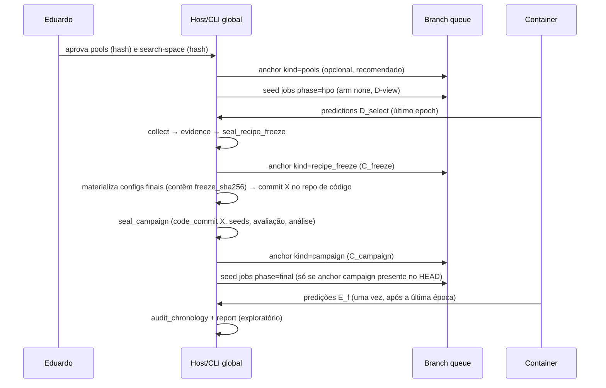

# Integração global D/E: produtor HPO, selagem, treino final e multilabel — especificação v0.1

**Estado: especificação de arquitetura aprovada em 19/10/2026 com as
recomendações (decisões Q1–Q13 na seção 12). Nenhum job, servidor, dado ou
freeze real foi criado ou executado por este documento; a fatia S0 (seção 9) é
só código offline.** Ela descreve
o que construir e como encaixar no código existente; a implementação cabe a
outros agentes, em fatias revisáveis (seção 9). Tudo continua
`scientific_status="provisional"`; `execution_verified` e `scientific_eligible`
permanecem **sempre `false`** em todas as fatias aqui descritas.

Base lida (worktree `augment-atlas-application-20261016`, HEAD `b7a47f5`):
`global_development.py` e seus testes (fundação offline **aceita**), `train.py`,
`evaluation.py`, `contracts.py`, `data.py`, `scientific_splits.py`, `cli.py`,
`queue.py`, `runtime.py`, `schema.py`, `tests/test_selection_only.py`, docs
`global-development-contract.md`, `dataset-protocol-update.md`,
`clinical-metrics.md`, `scientific-design.md`, `protocol-draft.md`, `queue.md`,
o desenho anterior `cheap-hpo-next-contract.md` e as notas do Brain citadas no
pedido. Um backend-dev está editando `evaluation/train/runtime/contracts/cli`
agora: esta especificação reduz os pontos de contato nesses arquivos a
**ganchos pequenos de despacho** e coloca a lógica nova em módulos novos.

---

## 1. Decisão do Eduardo (parte crítica, preservada)

**Um HPO por dataset, receita compartilhada pelos 10 braços, HPO feito sem
augmentation.**

1. Particionar grupos/pacientes **uma vez**: D ≈ 20 % (desenvolvimento) e
   E ≈ 80 % (avaliação), listas e hashes congelados. **D nunca é teste.**
2. O HPO usa folds aleatórios próprios só dentro de D (D_fit/D_select agrupados
   por paciente, seeds próprias). Orçamento barato (poucos candidatos × 1 seed ×
   ≤ 20 épocas). **Nada de E influencia a escolha.**
3. Congelar receita, pré-processamento, número de épocas e limiares **antes de
   abrir E**; selar com hash.
4. Reembaralhar: folds de avaliação com **nova seed** sobre E (5 folds
   agrupados, cobertura de E exatamente 1×).
5. Em cada fold f: modelo novo (ImageNet), treinar em D ∪ (E \ E_f) com receita
   congelada e épocas fixas, testar E_f só no final; não escolher época/modelo
   em E_f; **não carregar checkpoint do HPO**.
6. 10 braços sobre os mesmos folds; seeds múltiplas conforme orçamento.

**Ressalva obrigatória (código e docs):** reembaralhar não remove viés se
pacientes usados para escolher hiperparâmetros caírem no teste (Bradshaw 2023,
DOI 10.1148/ryai.220232); por isso D fica fora de todos os testes. Folds de
teste incluindo D só com nova decisão do Eduardo e rótulo "exploratório" —
**não implementado nesta especificação**. `execution_verified` e
`scientific_eligible` ficam sempre falsos até haver produtor, runtime,
PatientID e cronologia reais e revisados.

**Caveat INbreast:** só 4 grupos/4 positivas em D_select ⇒ HPO instável.
**Decidido (Q1, 19/10/2026):** receita externa fixa no INbreast (sem HPO). PatientID não comprovado ⇒ piloto, não confirmatório. Pools
auditados: D 77 img/21 grupos, D_fit 59/17, D_select 18/4, E 310/82.

**Métricas primárias:** INbreast AUROC; DR ordinal QWK; pele: emenda ISIC2020
binária (melanoma vs demais) com AUROC binária primária e AP secundária
principal (Q12, decidida 19/10/2026; macro-AUROC OvR fica para pele multiclasse); tórax multilabel
macro-AUROC com política de incerteza fixa (CheXpert -1/blank). Secundárias:
macro-F1, balanced accuracy, AUPRC. Classe ausente ⇒ indefinido explícito.

Implementação da ressalva: (a) constante textual `SELECTION_BIAS_CAVEAT` em
`global_campaign.py`, citada no docstring de todos os módulos `global_*`; (b) o
campo fechado `caveats` do selo de campanha (seção 6.9) exige o identificador
`bradshaw_2023_shuffle_does_not_remove_selection_bias`; (c) o relatório final
(6.10) imprime a ressalva no cabeçalho. Um teste verifica as três presenças.

---

## 2. Estado real e lacunas concretas encontradas

| # | Fato no código | Consequência para esta integração |
|---|---|---|
| L1 | `train.run` escolhe `best_model` pela **mínima selection loss** a cada época (`train.py:287-292`) | Treino final e HPO global precisam de `checkpoint_selection="last_epoch"`, sem partição de seleção |
| L2 | `validate_config` aceita só `phase="smoke"`; `selection-only` exige `hpo.protocol="within-outer-fold"` (`contracts.py:62,140`) | Não afrouxar. Fases `hpo`/`final` entram por **despacho de fase** para um validador novo; o smoke fica byte a byte igual |
| L3 | `data.audit_splits`/`prepare_splits` exigem exatamente `train/selection/test` cobrindo todo o manifesto | Adapter dedicado de "visão global" (HPO: D_fit/D_select sobre registros de D; final: train/test sobre todos) |
| L4 | `evaluation._context` reutiliza `audit_splits` de 3 partições e grava `selection_rule="minimum_selection_loss"` | Módulo novo `global_evaluation.py`; não mexer no legado (que também está em edição) |
| L5 | `runtime.preflight` recusa fase ≠ smoke; `config_for` exige `configs/smoke/`; `cli seed` só `smoke` | Ganchos de despacho por fase; CLI global separada (`global_cli.py`) |
| L6 | `schema.prepare_job` **já aceita** `phase ∈ {smoke,hpo,final}` com os 10 campos de identidade | Reutilizar sem mudar `IDENTITY_FIELDS` (IDs de jobs legados preservados) |
| L7 | Trainer fixa AdamW, `CosineAnnealingLR(T_max=epochs)` por época, CrossEntropy, clip 1.0, BN congelado | A receita v1 aceita nomes livres (`"sgd"` na fixture). É preciso um **registro fechado** receita→trainer; nome não suportado é erro |
| L8 | `selection_plan.producer.logs_sha256` precisa ser fixado **antes dos scores** e ser idêntico na evidência | Para produtor real, ele só pode significar "hash da *declaração* da política de logs"; logs reais ficam em `row.log_sha256`. Renomear numa v2 |
| L9 | `recipe.prediction` v1 não tem `comparison` (ge/gt) nem `tie_break`, exigidos por `clinical_metrics` | Fixar como **constantes do protocolo global v1** (`ge`, `first`), registradas no selo de campanha |
| L10 | `final_policy` exige exatamente 3 seeds | Piloto executa só a seed[0] (estágio 1) e o relatório declara a matriz incompleta; não alterar v1 |
| L11 | O auditor de pools não verifica se a seed de avaliação difere das seeds de desenvolvimento/seleção | Verificação nova no selo de campanha (sem mudar hashes v1) |
| L12 | `_task` rejeita `multilabel` | Protocolo v2 separado (seção 7.5); v1 escalar imutável |
| L13 | ~~Pools INbreast 387 vs manifesto endurance 1.024~~ **Resolvido 19/10 (maestro):** 1.024 (616/204/204) é o soak SINTÉTICO `synthetic-endurance-1024` (`configs/smoke/endurance-v1/synthetic/none.json`, `docs/endurance-test.md` §2); o INbreast endurance usa o manifesto de 387 imagens (248/62/77). Ainda exigir `records_sha256` igual ao dos pools auditados | — |

---

## 3. Stack

| Decisão | Escolha | Justificativa (1 linha) | Descartada e por quê |
|---|---|---|---|
| Linguagem/infra | Python stdlib + container PyTorch existente | Já testado, sem dependência nova | — |
| Busca HPO | **Grade fixa** de ≤ 6 candidatos, expansão determinística | Com 1 seed e ≤ 6 trials, amostrador adaptativo não traz ganho e complica a pré-declaração | Optuna: nova dependência, estado de study, amostragem adaptativa difícil de selar antes dos scores |
| Rastreio de experimentos | Documentos JSON privados com hash + fila Git | Reusa `canonical_hash`, `_publish` no-clobber e fila já validada | MLflow/DB: servidor extra, superfície de vazamento de IDs, nada que hashes não façam aqui |
| Cronologia | Âncoras públicas (só hashes) na branch `queue` + ancestralidade Git | Fast-forward-only já é invariante da fila; auditável por terceiros | Serviço de timestamp externo: custo e dependência; fica opcional (snapshot da API de eventos do GitHub) |
| Isolamento do HPO | Diretório D-only por hardlinks montado como `/data` | Prova física barata de que E não estava acessível ao container | Só guarda em software: depende de confiar no código do trainer |
| Split multilabel | Atribuição por hash de grupo + auditoria de viabilidade | Determinístico, stdlib, sem retry | Estratificação iterativa multilabel: dependência extra e sem suporte a grupos no sklearn |

---

## 4. Arquitetura

### 4.1 Componentes e fluxo de dados

```mermaid
flowchart LR
  subgraph PRIV["Raiz privada de dados (servidor, read-only nos containers)"]
    M[manifesto + imagens]
    P[pools-SHA.json<br/>D, D_fit, D_select, E, 5 folds]
    HV[hpo-view-SHA.json<br/>só registros de D]
    FZ[freeze-SHA.json ou<br/>external-freeze-SHA.json]
    EV[evidence-SHA.json<br/>ledger candidato×seed]
    CP[campaign-SHA.json]
  end
  subgraph HOST["Host (fora do container)"]
    DV[views/POOLS/D/<br/>hardlinks só de D]
    SEAL[global_campaign<br/>seal + anchors + chronology]
    COL[global_hpo.collect<br/>recalcula métricas]
    REP[global_report]
    W[runtime.worker<br/>fase hpo | final]
  end
  subgraph CODE["Repo de código (commit fixo)"]
    CFG[configs/global/DS/hpo|final/*.json<br/>+ MANIFEST.json]
  end
  subgraph Q["Branch queue (GitHub)"]
    J[jobs/*.md]
    A[anchors/DS/*.json<br/>só hashes]
  end
  subgraph CT["Container treino (--network none)"]
    T[train.run → global path<br/>last_epoch, ImageNet novo]
  end

  M --> P --> HV --> DV
  P --> SEAL
  W -- claim --> J
  W -- monta D-view como /data --> T
  W -- monta raiz completa como /data --> T
  CFG --> T
  T -- predictions.json + 8 artefatos --> COL
  COL --> EV --> SEAL --> FZ
  FZ --> CFG
  SEAL --> CP
  SEAL -- publish_anchor --> A
  A -- pré-condição de seed_final --> J
  T -- predições E_f --> REP
  CP --> REP
```

### 4.2 Cronologia verificável (ordem obrigatória)



Invariante central: **todo commit que introduz um job `final` do dataset é
descendente de `C_campaign`, que é descendente de `C_freeze`; nenhum job `hpo`
desse `pools_sha256` aparece depois de `C_freeze`.**

---

## 5. Estrutura de módulos e arquivos

```text
src/augment_atlas/
  global_development.py   # EXISTENTE (aceito). Mudanças aditivas apenas:
                          #  - kind de evidência "queue_collected_v1" (7.1)
                          #  - protocolo v2 multilabel (7.5), v1 escalar intocado
  global_jobs.py          # NOVO. Schema fechado de config hpo/final, registro
                          #  receita→trainer, derivação de visões, specs de fila,
                          #  materializador de configs + MANIFEST
  global_hpo.py           # NOVO. search-space, expansão de candidatos, build do
                          #  plan v1, hpo-view, coletor de evidência
  global_evaluation.py    # NOVO. Artefato de predições global, composição de
                          #  métricas (escalar e multilabel), validação por recálculo
  global_campaign.py      # NOVO. external freeze, selo de campanha, âncoras,
                          #  audit_chronology, SELECTION_BIAS_CAVEAT
  global_report.py        # NOVO. Agregação 5 folds × braços × seeds, pareamento
  global_cli.py           # NOVO. Entry point separado de cli.py (que está em edição)
  contracts.py            # GANCHO: validate_config despacha phase∈{hpo,final}
  train.py                # GANCHO: run() despacha para _run_global(cfg, ...)
  runtime.py              # GANCHO: preflight/config_for/create/validate_artifacts por fase
  queue.py                # ADITIVO: publish_anchor, read_path, seed_final
configs/global/<dataset>/{hpo,final}/*.json + MANIFEST.json   # gerados, commitados
tests/
  test_global_jobs.py, test_global_hpo.py, test_global_evaluation.py,
  test_global_campaign.py, test_global_chronology.py, test_global_report.py,
  test_global_multilabel.py, test_global_runtime.py (mocks Docker/Git),
  test_global_trainer.py (toy real, gate ATLAS_CONTAINER_CPU_TESTS=1)
```

Layout privado (nunca no Git; IDs e grupos são sensíveis):

```text
<data_root>/global/<dataset>/pools-<sha>.json
<data_root>/global/<dataset>/hpo-view-<sha>.json
<data_root>/global/<dataset>/{search-space,plan,evidence,freeze,campaign}-<sha>.json
<host>/views/<pools_sha>/D/            # hardlinks das imagens de D + hpo-view + LISTING.json
<runs>/<job_id>/<attempt_id>/          # já existente
```

---

## 6. Contratos

Convenções herdadas da v1: schemas fechados (`set(keys)` exato), inteiros
rejeitam bool, números finitos, hashes `[0-9a-f]{64}`, listas de IDs ordenadas e
únicas, `sha256` canônico exclui só ele mesmo, publicação por `_publish`
(hardlink exclusivo, idempotente, sem `os.replace` no destino). Erros
estruturais: `ValueError("<código>: <mensagem>")` com os códigos da seção 6.11.

### 6.1 `search-space.json` (pré-registrado antes de qualquer job HPO)

```json
{
  "schema_version": 1,
  "protocol": "global-hpo-search-space-v1",
  "scientific_status": "provisional",
  "dataset": {"id": "str", "version": "str"},
  "pools_sha256": "hex64",
  "task": "<cópia exata de pools.task>",
  "base_recipe": "<recipe v1 completo; campos variados carregam o valor default>",
  "grid": [
    {"path": "optimizer.parameters.lr", "values": [0.00003, 0.0001, 0.0003, 0.001]}
  ],
  "default": {"optimizer.parameters.lr": 0.0001},
  "seeds": [101],
  "failure_policy": "require_all_defined",
  "budget": {"max_candidates": 6, "max_seeds": 2, "max_epochs": 20,
             "job_timeout_s": 3600, "gpu_minutes_cap": 120},
  "retry_policy": "infrastructure_only_before_predictions",
  "sha256": "hex64"
}
```

Invariantes:
- `path` pertence ao registro fechado `{optimizer.parameters.lr,
  optimizer.parameters.weight_decay, epochs}`; valores ordenados, únicos,
  finitos; `epochs ≤ budget.max_epochs`.
- Produto cartesiano ≤ `max_candidates`; `len(seeds) ≤ max_seeds`; `default`
  pertence ao produto; `base_recipe` passa por `global_development._recipe` e
  pelo registro receita→trainer (6.4).
- **Expansão determinística:** `c00` = default; depois o restante do produto em
  ordem lexicográfica (ordem de `grid`, depois ordem de `values`) → `c01…`.
  Como o desempate v1 é `candidate_id` ascendente, **empate favorece o
  default** (escolha conservadora pré-declarada).
- `candidate.parameters` = `{nome_curto: valor}` (`lr`, `weight_decay`,
  `epochs`); `candidate.augmentation = {"arm":"none","ops":[]}`.
- `retry_policy`: reexecução manual só para job `failed/interrupted` **sem**
  `predictions.json`; um job com predição nunca é refeito. O ledger registra o
  número de tentativas.

`build_selection_plan(search_space, pools, *, producer, runtime, final_policy)
-> plan` gera o **plan v1 existente, sem mudar o schema**, e
`audit_plan_from_search_space(plan, search_space)` recalcula a expansão e exige
igualdade canônica. O hash do search-space é ancorado externamente como o do
plan (o selo de campanha liga os dois).

Semântica do `producer` real (lacuna L8): `id="augment-atlas-global-hpo-v1"`;
`code_sha256` = hash canônico de `[(path, sha256)]` de `src/` no commit;
`environment_sha256` = hash de `{image_id, probe}` do runtime;
`manifest_sha256` = `view_files_sha256` da D-view (6.3); `logs_sha256` = hash da
**declaração** da política de logs (`{"docker_log":"docker.log","per_row":true}`),
nunca dos logs reais.

### 6.2 Métrica de seleção em D_select (por task)

| Task | Endpoint do plan (= primário) | Regra | Faixa |
|---|---|---|---|
| binary (INbreast, ISIC2020 com emenda) | `binary_auroc` | scores da classe positiva | [0,1] |
| ordinal (DR 0–4) | `quadratic_weighted_kappa` | argmax, `tie_break="first"` | [-1,1] |
| multiclass (pele) | `macro_auroc_ovr` | scores softmax | [0,1] |
| multilabel (tórax, v2) | `multilabel_macro_auroc` | sigmoid por label; política de incerteza de avaliação dos pools | [0,1] |

Seleção = média das seeds (`math.fsum`, ordem canônica) descendente, desempate
por `candidate_id` (v1). Calculada sobre o **modelo da última época**, o mesmo
critério usado no treino final (ADR-05). Métrica indefinida ⇒ linha
`completed/undefined` com razão; `require_all_defined` impede elegibilidade
contratual (nunca vira zero). INbreast: 4×14 = 56 pares positivo–negativo em
D_select, granularidade 1/56 de AUROC ⇒ empates prováveis; o desempate favorece
`c00`.

### 6.3 `hpo-view.json` (o container HPO nunca recebe IDs de E)

```json
{
  "schema_version": 1,
  "protocol": "global-hpo-view-v1",
  "scientific_status": "provisional",
  "dataset": {"id": "str", "version": "str"},
  "task": "<pools.task>",
  "pools_sha256": "hex64",
  "records": [{"id": "str", "path": "str", "group": "str", "label": 0}],
  "lists": {"train": ["<D_fit>"], "selection": ["<D_select>"]},
  "view_files_sha256": "hex64",
  "sha256": "hex64"
}
```

Invariantes: `derive_hpo_view(records, pools, *, expected_pools_sha256)` usa
`_anchored_pools`; `records` = exatamente os registros de D;
`lists.train == pools.lists.D_fit` e `lists.selection == pools.lists.D_select`;
nenhum ID/grupo de E. `view_files_sha256` = hash canônico de
`[(path, file_sha256)]` dos arquivos realmente presentes em `views/<pools>/D/`
(construído por `materialize_d_view`: hardlink, com fallback de cópia verificada
por hash; filesystem sem hardlink e sem espaço ⇒ erro, sem fallback silencioso).
O runtime recusa montar a D-view se o listing recalculado divergir.

### 6.4 Config de job `phase="hpo" | "final"` (schema fechado, `global_jobs`)

```json
{
  "schema_version": 1,
  "phase": "hpo | final",
  "scientific_status": "provisional",
  "protocol_version": "global-hpo-v1 | global-final-v1",
  "dataset": {"id": "str", "version": "str", "adapter": "manifest_csv | inbreast_csv",
              "manifest": "rel/path.csv", "manifest_sha256": "hex64",
              "require_image_hashes": true},
  "global": {
    "pools_file": "global/<ds>/pools-<sha>.json", "pools_sha256": "hex64",
    "view": "hpo | final",
    "hpo_view_file": "str | null", "hpo_view_sha256": "hex64 | null",
    "plan_sha256": "hex64 | null", "search_space_sha256": "hex64 | null",
    "candidate_id": "str | null", "candidate_config_sha256": "hex64 | null",
    "freeze_kind": "hpo_d | external_fixed | null",
    "freeze_file": "str | null", "freeze_sha256": "hex64 | null",
    "fold": "0..4 | null"
  },
  "model": {"name": "resnet50", "weights": "IMAGENET1K_V2", "weights_sha256": "hex64",
            "num_outputs": 2, "head": "softmax | sigmoid", "init": "imagenet_fresh"},
  "input": {"size": 224, "color": "grayscale_to_rgb | rgb"},
  "augmentation": "<preset do braço; hpo exige {arm:none, ops:[]}>",
  "training": {"seed": 0, "epochs": 20, "batch_size": 16, "accumulation_steps": 1,
               "optimizer": {"name": "adamw", "lr": 0.0001, "weight_decay": 0.0001},
               "scheduler": {"name": "cosine_per_epoch", "eta_min": 0.0},
               "loss": {"name": "cross_entropy | bce_with_logits_masked"},
               "checkpoint_selection": "last_epoch", "early_stopping": false,
               "device": "cuda", "workers": 2, "deterministic": true,
               "autocast": false, "tf32": false},
  "evaluation": {"schema_version": 1, "task": "...", "classes|labels": [], "score_kind": "...",
                 "decision": {"rule": "...", "threshold": 0.5, "comparison": "ge", "tie_break": null},
                 "frozen": true}
}
```

Regras:
- `hpo`: `global.view="hpo"`, campos `hpo_*`, `plan_*`, `candidate_*` não nulos,
  `freeze_*`/`fold` nulos, augmentation `none`. `final`: o inverso, `fold ∈ 0..4`.
- **Não existe** chave `init_checkpoint`, `pretrained_path`, `warm_start` ou
  `evaluation_scope` (schema fechado ⇒ qualquer uma é erro
  `init_checkpoint_forbidden`).
- **Registro receita→trainer v1 (fechado):** `optimizer.name="adamw"` com
  parâmetros exatamente `{lr, weight_decay}`; `scheduler.name="cosine_per_epoch"`
  com `{eta_min}`; `loss.name ∈ {cross_entropy (escalar),
  bce_with_logits_masked (multilabel)}`, `parameters={}`. Nome fora do registro
  ⇒ `recipe_adapter_unsupported`. Constantes do trainer fora da receita (clip
  1.0, BN congelado, FP32, determinismo, resize bilinear, normalização ImageNet)
  ficam em `TRAINER_CONSTANTS_V1` e são copiadas no selo de campanha.
- `training` deve ser igual a `recipe_to_training(frozen_recipe ou
  candidate.recipe, seed)`; divergência ⇒ `recipe_mismatch`.
- Materialização: `materialize_configs(phase, ...)` gera um arquivo por job em
  `configs/global/<ds>/<phase>/<arm>-f<fold>-s<seed>.json` (ou
  `<cand>-s<seed>.json`) e um `MANIFEST.json` `{files:[{path, sha256}],
  phase, pools_sha256, freeze_sha256|plan_sha256, sha256}`. Determinístico:
  regerar não muda bytes. Os configs contêm nomes de arquivo privados, não IDs.

### 6.5 Spec de fila (sem mudar `IDENTITY_FIELDS`)

| Campo de identidade | HPO | Final |
|---|---|---|
| `protocol_version` | `"global-hpo-v1"` | `"global-final-v1"` |
| `dataset`, `dataset_version` | do pools | do pools |
| `split_hash` | `hpo_view.sha256` | `canonical_hash(final_fold_view(...))` do fold |
| `recipe_hash` | `canonical_hash(candidate)` (= `config_sha256` do ledger) | `freeze_sha256` |
| `phase` | `"hpo"` | `"final"` |
| `fold` | `0` (convenção; o view decide) | `f` |
| `train_seed` | seed do search-space | seed de `final_policy.seeds` |
| `arm` | `"none"` | braço de `ARMS` |
| `code_commit` | commit do HPO | commit X da campanha |

Implementação S0: o `split_hash` final é o `sha256` do documento
`derive_final_view_doc` (algoritmo `global-final-view-v1`: train/test do
`final_fold_view`, grupos, `pools_sha256`, `freeze_sha256`, `fold`), que liga
estritamente mais que `canonical_hash(final_fold_view(...))`; é o mesmo corpo do
`splits.json` da seção 7.3.

Campos extras imutáveis: `global = {pools_sha256, plan_sha256|null,
search_space_sha256|null, candidate_id|null, freeze_sha256|null,
campaign_sha256|null, freeze_kind|null}`, `config`, `config_sha256`,
`dependencies=[]`, `compatibility`. O runtime de fase `final` só aceita o job se
o HEAD da fila contiver `anchors/<ds>/campaign-<campaign_sha256>.json`.

### 6.6 `predictions.json` global (9º artefato, obrigatório em hpo/final)

```json
{
  "schema_version": 1,
  "artifact_type": "global_predictions",
  "visibility": "private",
  "phase": "hpo | final",
  "dataset": {"id": "str", "version": "str"}, "task": "<pools.task>",
  "pools_sha256": "hex64", "view_sha256": "hex64",
  "plan_sha256": "hex64|null", "candidate_id": "str|null",
  "freeze_sha256": "hex64|null", "fold": "int|null",
  "arm": "str", "train_seed": 0, "config_sha256": "hex64",
  "checkpoint_selection": "last_epoch", "epoch": 20, "epochs": 20,
  "partition": "D_select | E_test",
  "score_kind": "softmax_probability | sigmoid_probability",
  "decision": {"rule": "...", "threshold": "num|null", "comparison": "ge|null", "tie_break": "first|null"},
  "rows": [{"id": "str", "group": "str", "target": "int | [1,0,-1,null,...]",
            "scores": [0.1, 0.9], "prediction": "int|null"}],
  "metrics": {"primary": {"metric": "...", "value": "num|null", "reason": "str|null", "coverage": {}},
              "secondary": {"macro_f1": {}, "balanced_accuracy": {}, "average_precision": {}}},
  "content_sha256": "hex64"
}
```

Invariantes: `epoch == epochs`; linhas ordenadas por ID e iguais **exatamente**
à partição avaliada (D_select ou E_f); `validate_global_predictions(cfg, view,
records, artifact)` reconstrói decisões e métricas a partir de `scores` (padrão
de `evaluation.validate_prediction_artifact`) e exige igualdade canônica.
Secundárias que exigem decisão: binária usa o limiar selado; multilabel em v1
só reporta AP macro (6.9). O conjunto de artefatos fica `BASE_REQUIRED_ARTIFACTS
+ ("predictions.json",)` — `contracts.required_artifacts` já faz isso quando
`"evaluation" in cfg`, e configs globais sempre têm `evaluation`. `best.pt`
mantém o nome por compatibilidade, com conteúdo `{model, epoch: epochs,
checkpoint_selection: "last_epoch"}`.

### 6.7 Evidência coletada (`kind="queue_collected_v1"`)

Schema = evidence v1 existente. Mudança aditiva em `global_development._evidence`:
aceitar `kind="queue_collected_v1"`; para esse kind,
`scientific_reasons = ["execution_unverified", "runtime_isolation_unverified",
"chronology_unverified", "queue_collected_v1"]` (os kinds v1 continuam com as
razões atuais ⇒ hashes das fixtures aceitas não mudam). `scientific_eligible`
continua `false`.

`collect_hpo_evidence(search_space, plan, plan_sha256, view, queue_snapshot,
runs_root) -> (evidence, collection_manifest)` — para cada (candidato, seed):
1. localizar o job pela identidade 6.5; estado da fila `succeeded` ⇒ validar
   artefatos globais, recalcular a métrica a partir de `predictions.json` e
   exigir igualdade com a declarada; `failed/timeout` ⇒ linha `unavailable` com
   razão e `log_sha256` do `docker.log`; ausente ⇒ linha `missing` explícita.
2. `artifact_sha256 = predictions.content_sha256`; `log_sha256 =
   file_hash(docker.log)`; `train_ids = D_fit`, `select_ids = epoch_ids =
   threshold_ids = D_select` (as duas últimas são declarações: épocas e
   limiares estão fixos no candidato).
3. Recusar se: `runtime.json` do attempt não registrar montagem da D-view com o
   `view_files_sha256` declarado (`hpo_isolation_unproven`); `config_sha256` do
   job ≠ candidato; algum job HPO tiver `search_space_sha256` diferente.

`collection_manifest` (privado, separado): por linha `{job_id, attempt_id,
attempts, queue_state, completed_sha256, predictions_sha256, recomputed_metric,
docker_log_sha256, data_mount_source_kind:"d_view", view_files_sha256}`.

### 6.8 `external-freeze.json` (caminho alternativo explícito, INbreast)

```json
{
  "schema_version": 1,
  "protocol": "global-recipe-external-v1",
  "scientific_status": "provisional",
  "dataset": {"id": "str", "version": "str"}, "task": "<pools.task>",
  "pools_sha256": "hex64",
  "recipe": "<recipe v1; augmentation none implícito>",
  "source": {"kind": "literature | convention | other_dataset",
             "reference": "str (DOI/URL/descrição)",
             "derived_from_this_dataset_scores": false,
             "notes": "str"},
  "selection_scope": {"data_used_for_selection": "none", "D_role": "final_training_only"},
  "runtime": {"commit": "hex40", "environment_sha256": "hex64", "imagenet_weights_sha256": "hex64"},
  "final_policy": "<final_policy v1>",
  "label": "exploratory",
  "frozen_at_utc": "ISO UTC",
  "eligibility": {"contract_eligible": false, "scientific_eligible": false,
                  "execution_verified": false, "reasons": [], "scientific_reasons": []},
  "sha256": "hex64"
}
```

Invariantes: reusa `_recipe`, `_runtime`, `_final_policy`, `_anchored_pools`;
`derived_from_this_dataset_scores` precisa ser `false` — receita escolhida
olhando scores do piloto INbreast é recusada (`external_recipe_contaminated`);
`label="exploratory"` obrigatório quando `pools.grouping.prior_exposure ≠
"none_documented"` ou a identidade de paciente não está comprovada.
`eligibility` derivada; `reasons` sempre inclui `external_recipe_not_tuned_on_D`.
D continua fora dos testes (pools idênticos), para o piloto ensaiar o mesmo
pipeline dos outros datasets.

### 6.9 Selo de campanha `campaign.json` (privado) e âncora pública

```json
{
  "schema_version": 1,
  "protocol": "global-final-campaign-v1",
  "scientific_status": "provisional",
  "dataset": {"id": "str", "version": "str"}, "task": "<pools.task>",
  "pools_sha256": "hex64",
  "freeze": {"kind": "hpo_d | external_fixed", "sha256": "hex64",
             "plan_sha256": "hex64|null", "evidence_sha256": "hex64|null",
             "search_space_sha256": "hex64|null"},
  "evaluation": {
    "primary": "binary_auroc | quadratic_weighted_kappa | macro_auroc_ovr | multilabel_macro_auroc",
    "secondary": ["macro_f1", "balanced_accuracy", "average_precision"],
    "decision": {"rule": "fixed_threshold | argmax | scores_only", "threshold": 0.5,
                 "comparison": "ge", "tie_break": null},
    "multilabel": null,
    "undefined_policy": "propagate_no_drop",
    "aggregation": {"primary": "mean_over_folds_then_seeds", "secondary": ["pooled_E_per_seed"]}
  },
  "arms": ["<ARMS na ordem de contracts>"],
  "augmentation_presets_sha256": "hex64",
  "folds": [0, 1, 2, 3, 4],
  "seeds": [11, 13, 19],
  "execution_stages": [{"stage": 1, "seeds": [11]}, {"stage": 2, "seeds": [13, 19]}],
  "runtime": {"code_commit": "hex40", "image_id": "sha256:...", "imagenet_weights_sha256": "hex64",
              "trainer_constants": "<TRAINER_CONSTANTS_V1>"},
  "configs": {"root": "configs/global/<ds>/final", "manifest_sha256": "hex64", "count": 150},
  "analysis_plan_sha256": "hex64 | null",
  "label": "exploratory | confirmatory_candidate",
  "label_reasons": ["prior_exposure_known", "patient_identity_unproven"],
  "caveats": ["bradshaw_2023_shuffle_does_not_remove_selection_bias",
              "D_never_tested", "E_folds_not_cv_over_full_population",
              "recipe_transferred_from_small_D_to_larger_pool"],
  "sealed_at_utc": "ISO UTC",
  "eligibility": {"execution_verified": false, "scientific_eligible": false, "blockers": ["..."]},
  "sha256": "hex64"
}
```

Invariantes de `seal_campaign(...)` (todas verificadas, nenhuma aceita por
declaração):
- freeze auditado (`audit_recipe_freeze` com plan/evidence ancorados, ou
  `audit_external_freeze`); `seeds == freeze.final_policy.seeds`; `arms ==
  ARMS`; `augmentation_presets_sha256 == final_policy.augmentation_presets_sha256`.
- **Seeds disjuntas:** `seeds ∩ search_space.seeds = ∅`; seed de avaliação dos
  pools ∉ {development, selection} (lacuna L11) ⇒ `seed_reuse_forbidden`.
- `runtime.code_commit == freeze.runtime.commit` (Q6, decidida 19/10/2026); exceção só
  com nova decisão e campo `runtime_amendment` numa v2.
- `configs.manifest_sha256` = recálculo determinístico da materialização final;
  `count == len(arms) × 5 × len(seeds)`.
- `decision` constante por task: binária `fixed_threshold` com o limiar do
  `frozen_recipe.prediction` e `comparison="ge"`; ordinal/multiclasse `argmax`,
  `tie_break="first"`; multilabel `scores_only`.
- `label` derivado: `exploratory` se houver `prior_exposure ≠ none_documented`,
  identidade de paciente não comprovada, `analysis_plan_sha256 = null` ou freeze
  externo em dataset exposto. INbreast ⇒ sempre `exploratory`.
- `caveats` contém exatamente o conjunto fixo acima. `blockers` derivados:
  `execution_unverified`, `runtime_isolation_unverified`,
  `chronology_unverified`, mais as razões de identidade/exposição.
- Recusa selar se já existir na fila **qualquer** job `final` com o mesmo
  `pools_sha256` (`final_job_before_seal`).

Âncora pública (`anchors/<dataset_id>/<kind>-<sha256-do-documento>.json` na
branch `queue`; **sem IDs, grupos ou caminhos privados**):

```json
{
  "schema_version": 1,
  "protocol": "global-anchor-v1",
  "kind": "pools | recipe_freeze | campaign",
  "dataset": {"id": "str", "version": "str"},
  "pools_sha256": "hex64",
  "document_sha256": "hex64",
  "freeze_sha256": "hex64|null", "campaign_sha256": "hex64|null",
  "code_commit": "hex40|null",
  "label": "exploratory | confirmatory_candidate | null",
  "document_utc": "ISO UTC",
  "caveat": "Reembaralhar folds não remove viés se pacientes usados na seleção caírem no teste (Bradshaw 2023, DOI 10.1148/ryai.220232); D fica fora de todos os testes.",
  "sha256": "hex64"
}
```

`GitQueue` (aditivo): `publish_anchor(doc)` — mesmo laço fetch/commit/push/refetch
de `seed`; caminho existente com bytes idênticos ⇒ idempotente; diferente ⇒
`QueueConflict("anchor_conflict")`. `read_path(head, path)`. `seed_final(specs,
campaign_sha256)` — dentro do laço de retry, antes de `_publish`, exige a âncora
de campanha **no `head` sobre o qual o commit será construído** (logo, o commit
dos jobs é filho de um commit que contém a âncora) e `spec.global.campaign_sha256`
igual. `_records` continua lendo só `jobs/`.

### 6.10 Relatório final `report.json` (privado) + resumo público

`build_report(campaign, pools, records, run_dirs, queue_snapshot)`:
- Verifica por (braço, seed): 5 artefatos `final`, todos ligados ao mesmo
  `campaign/freeze/pools`; união dos `rows.id` == E **exatamente uma vez**;
  nenhum ID de D; cada linha pertence ao `test` do seu fold e não ao `train`.
- Calcula: métrica por (braço, seed, fold); primária = média dos 5 folds
  (indefinida se algum fold indefinido, sem média parcial) e depois média das
  seeds executadas; secundária = métrica sobre as predições de E concatenadas
  por seed (`pooled_E`); diferenças pareadas braço − `none` por (seed, fold).
- Incerteza/contrastes/multiplicidade só se `analysis_plan_sha256 ≠ null`; sem
  plano, o relatório é descritivo e rotulado `exploratory`.
- Completude: matriz planejada × executada, falhas e motivos; nenhuma célula
  some. Cabeçalho com `SELECTION_BIAS_CAVEAT`, `label`, `blockers`,
  `execution_verified=false`, `scientific_eligible=false`.
- Verificação de pareamento: `environment.initial_state_sha256` (hash do
  `state_dict` antes da 1ª atualização) idêntico entre os 10 braços do mesmo
  (fold, seed) e diferente entre seeds — prova operacional de ImageNet novo,
  cabeça semeada e ausência de warm start.

### 6.11 Catálogo de erros (prefixo estável de `ValueError`)

`records_identity_mismatch`, `pools_anchor_mismatch`, `view_hash_mismatch`,
`hpo_view_contains_E`, `hpo_isolation_unproven`, `search_space_mismatch`,
`plan_not_from_search_space`, `recipe_adapter_unsupported`, `recipe_mismatch`,
`freeze_not_sealed`, `freeze_anchor_missing`, `campaign_anchor_missing`,
`anchor_conflict`, `final_job_before_seal`, `hpo_job_after_freeze`,
`seed_reuse_forbidden`, `init_checkpoint_forbidden`,
`checkpoint_lineage_mismatch`, `test_access_before_last_epoch`,
`epoch_selection_forbidden`, `D_in_test`, `E_coverage_violation`,
`external_recipe_contaminated`, `multilabel_policy_missing`,
`metric_undefined:<reason>` (não é exceção: valor `null` com razão).

Códigos adicionados na fatia S0 (`global_jobs.py`, aditivos; divergência
registrada porque o catálogo original não cobria esses casos):
`global_config_invalid` (schema fechado/campos fixos do config global ou da
spec de fila), `hpo_augmentation_forbidden` (job HPO com braço ≠ `none` ou ops
não vazias), `materialization_conflict` (arquivo de config existente com bytes
diferentes ou arquivo estranho no diretório da fase; nada é sobrescrito),
`plan_invalid` (plan v1 que não passa no auditor ancorado; o recálculo a partir
do search-space continua sendo `plan_not_from_search_space`, S2).

Códigos adicionados na fatia S1 (`global_evaluation.py`, aditivos; o catálogo
original não distinguia esses casos do `predictions.json` global):
`predictions_invalid` (S1) (schema fechado do artefato/linhas, `content_sha256`
divergente, linhas fora da ordem por ID, divergência residual no recálculo),
`prediction_scores_invalid` (S1) (probabilidade não finita, fora de [0,1],
bool/string, largura ≠ número de classes, soma fora de 1 ± 1e-6, contagem de
linhas de scores ≠ partição), `prediction_identity_mismatch` (S1) (artefato
ligado a outro config/`config_sha256`, view, pools, freeze/campanha, plan,
candidato, fold, braço, seed ou decisão), `selection_coverage_violation` (S1)
(HPO sem cobrir D_select exatamente 1×; o análogo de `E_coverage_violation`),
`decision_recompute_mismatch` (S1) (decisão declarada ≠ regra selada aplicada
aos scores), `metric_recompute_mismatch` (S1) (métrica declarada ≠ recalculada).
Reuso S1: `D_in_test` (linha ou view final com ID de D), `hpo_view_contains_E`
(linha HPO ou hpo-view com ID/grupo de E, checado antes do vínculo ao config),
`E_coverage_violation`, `view_hash_mismatch`, `records_identity_mismatch`
(grupo/alvo da linha ≠ registros confiáveis), `epoch_selection_forbidden`
(`epoch ≠ epochs` ou `checkpoint_selection ≠ last_epoch`) e
`recipe_adapter_unsupported` com "slice S6" para multilabel. Divergência S1
registrada: `validate_global_predictions(cfg, view, records, artifact, *, pools)`
recebe os pools ancorados por `cfg.global.pools_sha256` (sem eles não há D/E
para `D_in_test`/`hpo_view_contains_E` nem re-derivação da view final); cada
objeto de métrica é `{metric, value, reason, coverage, per_class}` com
`reason = "metric_undefined:<razão>"` quando `value` é `null`.

Trainer S1 parte B (`train._run_global`; sem códigos novos, divergências
registradas): (a) o container HPO não lê `pools_file` nem o manifesto (ambos
listam E): registros e listas vêm só do hpo-view da D-view, checado por
`global_evaluation.check_hpo_view_local` (checksum, vínculo ao config, partição
exata D_fit/D_select sem grupo comum), e o artefato sai de
`build_hpo_predictions_from_view`, idêntico ao de `build_global_predictions`
com pools; o host continua recalculando com pools (`hpo_view_contains_E`). Sem
hashes por imagem no hpo-view, a integridade das imagens da D-view fica com o
listing do runtime. (b) `splits.json` é o próprio documento de visão (hpo-view
ou `derive_final_view_doc`), logo `splits_sha256 == split_hash` nas duas fases.
(c) `config_sha256` nos artefatos globais é o hash dos bytes materializados
(`render_config_bytes`, = spec da fila), não `canonical_hash(cfg)` do legado;
`config.json` é gravado com esses bytes. (d) `--resume` só aceita o
`checkpoint.pt` do próprio attempt e exige `lineage = {trainer, phase,
config_sha256, splits_sha256, initial_state_sha256, trainer_override}` igual;
caminho estranho ou linhagem diferente ⇒ `checkpoint_lineage_mismatch` antes de
qualquer escrita no checkpoint. (e) CPU/0 workers só via argumento
`run(..., trainer_override={device: cpu, workers: 0, reason})`, que a CLI não
expõe, exige `ATLAS_CONTAINER_CPU_TESTS=1` e é gravado em checkpoint,
`environment`, `results` e `completed` (o runtime deve recusar attempts com
override não nulo); `TRAINER_CONSTANTS_V1` e o config ficam intocados. (f) A
cabeça é re-semeada com `seed` depois de carregar o ImageNet, então
`initial_state_sha256` depende só da seed (pareamento entre braços). (g) v1
exige `classes == 0..num_outputs-1` e operações do backend
`candidate-opencv-v2` (resize antes da augmentation, como em
`TRAINER_CONSTANTS_V1`); fora disso ⇒ `recipe_adapter_unsupported`. (h)
`best.pt` = `{model, epoch: epochs, checkpoint_selection: "last_epoch",
config_sha256}`; `results` traz `test_evaluations`/`selection_evaluations` e o
acesso é registrado no checkpoint antes da leitura; reavaliação após retomada
precisa reproduzir o mesmo `content_sha256`.

---

## 7. Fluxos

### 7.1 Produtor HPO (D_fit/D_select)

1. Eduardo aprova `pools_sha256` (já selado pela v1) e o `search-space` (hash).
   Opcional/recomendado: âncora `kind=pools` na fila.
2. Host: `derive_hpo_view` → `materialize_d_view` (hardlinks só de D) →
   `build_selection_plan` → `audit_plan_from_search_space`; pin de
   `plan_sha256`.
3. `materialize_configs(phase="hpo")` → commit no repo de código → `seed` dos
   `len(candidates) × len(seeds)` jobs `phase=hpo`, `arm=none`.
4. Worker `phase=hpo`: `config_for` verifica config/manifesto, D-view listing,
   `split_hash == hpo_view.sha256`, `recipe_hash == canonical_hash(candidate)`;
   `create` monta **`views/<pools>/D` como `/data`** (a raiz completa não é
   montada); container treina em D_fit pelas épocas fixas, sem avaliação por
   época, e avalia D_select **uma vez** no último epoch.
5. `collect_hpo_evidence` → `evidence` (`queue_collected_v1`) →
   `seal_recipe_freeze(records, pools, candidate_freeze, evidence, ...)` (v1
   inalterado) → `publish_anchor(kind=recipe_freeze)`.
6. Orçamento: grade ≤ 6 × 1 seed × ≤ 20 épocas; timeout por job; o teto
   `gpu_minutes_cap` é verificado pelo coletor (soma de `FinishedAt−StartedAt`);
   estouro ⇒ linhas `timeout` explícitas, nunca nova rodada escolhida após ver
   scores.

**Modo receita externa fixa:** substitui os passos 2–5 por `seal_external_freeze`
→ âncora `recipe_freeze`. Nenhum job HPO existe para esse `pools_sha256`; o
auditor de cronologia exige isso.

### 7.2 Selagem e cronologia

Entram no hash, em camadas (cada camada referencia a anterior pelo hash):

| Item | Documento selado | Quando |
|---|---|---|
| registros, classes, grupos, pré-processamento, seeds de partição, D/D_fit/D_select/E, **5 folds de E** | `pools` (v1) | antes do HPO |
| política de incerteza multilabel, labels | `pools.task` (v2) | antes do HPO |
| espaço de busca, seeds HPO, orçamento | `search-space` | antes do HPO |
| receita, pré-processamento, épocas fixas, limiar, regra de predição, seeds finais, política final | `freeze` (v1) ou `external-freeze` | antes de qualquer config final |
| comparação `ge`/`tie_break`, agregação, braços/presets, commit/imagem, configs finais, plano de análise, rótulo, caveats | `campaign` | antes de qualquer job final |

`audit_chronology(queue_checkout, dataset, campaign_sha256) -> report`:
1. Histórico first-parent linear da branch `queue` (a fila só cria commits de
   um pai); `C_campaign` ancestral do HEAD atual (`merge-base --is-ancestor`)
   e igual ao commit registrado no momento da selagem (cópia privada + nota no
   Brain), detectando reescrita.
2. `C_freeze` (primeiro commit com a âncora de freeze) é ancestral de
   `C_campaign`; os arquivos de âncora nunca mudam depois de criados.
3. Nenhum commit anterior a `C_campaign` contém job `final` desse
   `pools_sha256`; todo job `final` aparece pela primeira vez em descendente.
4. Nenhum job `hpo` desse `pools_sha256` aparece em `C_freeze` ou depois; todos
   os jobs HPO do ledger já estavam terminais antes de `C_freeze`.
5. Timestamps como evidência de apoio (não primária):
   `freeze.frozen_at_utc ≤ data do commit C_freeze ≤ campaign.sealed_at_utc ≤
   data do commit C_campaign ≤ primeiro claim final (history.at)`. Inversão ⇒
   aviso com razão (relógios de host), não aprovação.
6. Opcional: snapshot privado da API de eventos do GitHub logo após cada
   âncora (horário de push do lado do servidor, retido ~90 dias).

Resultado continua `execution_verified=false`: quem controla o repositório
poderia, em tese, fabricar um histórico antes de publicá-lo. A âncora dá
**auditabilidade**, não prova criptográfica.

### 7.3 Consumidor do treino final (adapter D/E/final)

No container (`train._run_global`, fase `final`):
1. `validate_global_config`; carregar registros (`load_records`), projetar em
   `{id,path,group,label}` e exigir `canonical_hash == pools.records_sha256`.
2. Ler `pools_file` (hash == config) → `final_fold_view(records, pools, fold,
   expected_pools_sha256)`; ler `freeze_file` (hash == config) e exigir
   `recipe_to_training(freeze.frozen_recipe, seed) == cfg.training`.
3. Persistir `splits.json` com `algorithm="global-final-view-v1"`, `{train,
   test}`, grupos, `pools_sha256`, `freeze_sha256`, `fold`, `sha256`.
4. Modelo: `resnet50(weights=None)` + arquivo ImageNet com hash conferido;
   cabeça nova semeada; gravar `initial_state_sha256`. Não existe caminho para
   carregar outro estado, exceto `--resume` do **mesmo attempt**: o checkpoint
   precisa ter `phase="final"`, mesmo `config_sha256` e `splits_sha256` (um
   checkpoint HPO tem config e split diferentes ⇒ `checkpoint_lineage_mismatch`).
   O runtime não monta o diretório de runs HPO no container final.
5. Laço: épocas fixas, sem `evaluate("selection")`, sem early stopping;
   scheduler `CosineAnnealingLR(T_max=epochs)` por época (duração independente
   do tamanho do pool); atualizações por época = `ceil(ceil(n/batch)/accum)`,
   igual ao `final_steps` do auditor ⇒ divergência é erro.
6. Depois da **última** época: `best.pt` = estado final; construir o dataset de
   teste **uma vez** (guarda: construir/ler E_f antes disso ⇒
   `test_access_before_last_epoch`); `predictions.json` (partição `E_test`);
   `results.json` com `phase="final"`, `checkpoint_selection="last_epoch"`,
   `best_epoch == epochs`, `test`, `clinical_evaluation`. Reavaliação após
   retomada é permitida só com o mesmo estado final e precisa reproduzir o mesmo
   `content_sha256` (`test_evaluations` registrado).

Host (`runtime`, ganchos):
- `preflight`: aceita `phase ∈ {smoke, hpo, final}`; smoke inalterado.
- `config_for`: despacha por `spec.phase`; global exige prefixo
  `configs/global/<ds>/<phase>/`, `config_sha256` no `MANIFEST.json`, auditoria
  completa de pools/freeze/evidence/campaign **antes do claim**, `split_hash`
  recalculado, âncora de campanha no HEAD da fila (fase final).
- `create`: HPO monta a D-view; final monta a raiz completa read-only; nenhum dos
  dois monta runs de outros jobs.
- `validate_artifacts`: se `cfg.phase ∈ {hpo, final}` ⇒
  `global_jobs.validate_global_artifacts(out, spec)` (9 artefatos, `epoch ==
  epochs`, `checkpoint_selection`, `results` sem chave `selection` na fase final
  e sem `test` na fase HPO, `predictions` recalculadas). O ramo smoke, incluindo
  o `selection-only`, fica intocado.

Legado: smoke continua com 8 artefatos e `predictions.json` opt-in; nenhum teste
de `test_selection_only.py` ou `test_runtime.py` é adaptado.

**10 braços × seeds:** mesmos 5 folds e as mesmas seeds para todos os braços;
ordem de batches (`hash(seed, epoch, "order")`) e inicialização dependem só da
seed ⇒ desenho pareado. Execução por estágios, com a seed como laço externo
(`execution_stages`), todos os 50 jobs de uma seed antes da próxima.
Recomendação operacional: afinidade por (fold, seed) na mesma GPU, ou ao menos
`gpu_uuid` no relatório, para não confundir braço com hardware.

### 7.4 Agregação

Ver 6.10. Só E recebe predições fora da amostra; D nunca aparece no relatório
de teste. Não chamar o desenho de "CV5 sobre 100 % da população": cada teste
cobre ≈ 16 % da base. Seeds e folds são medidas repetidas, não réplicas
clínicas independentes.

### 7.5 Multilabel (tórax)

**Pools v2 (`protocol="global-development-holdout-v2"`, só multilabel; v1
escalar intocado):**
- Registro: `{id, path, group, labels}` com `labels` de comprimento L e valores
  em `{0, 1, -1, null}` (CheXpert: 1.0→1, 0.0→0, -1.0→-1, blank→null; a
  normalização do adapter é declarada em `provenance.labels_sha256`).
- `task`:
  ```json
  {"type": "multilabel",
   "labels": ["Atelectasis", "Cardiomegaly", "Consolidation", "Edema", "Pleural Effusion"],
   "endpoint": "multilabel_macro_auroc", "decision_rule": "scores_only",
   "uncertainty": {"train_uncertain": "ignore | zeros | ones",
                   "train_blank": "negative | ignore",
                   "eval_uncertain": "exclude", "eval_blank": "negative | exclude"},
   "view_filter": "frontal_only | all",
   "missing_policy": "undefined_no_drop", "requires_patient_identity": true}
  ```
  Política ausente ou parcial ⇒ `multilabel_policy_missing`. Ela fica selada
  nos pools, ou seja, **antes do HPO**, e entra no freeze via `task`.
- Contagens por pool e por label (positivos/negativos/incertos/ausentes após a
  política de avaliação). Viabilidade: todo label com ≥ 1 positivo e ≥ 1
  negativo em D_select e em cada E_f (mínimo por label/fold fixado no `task`
antes do split, Q8 decidida 19/10/2026); senão
  `endpoint_feasible=false`, sem remover labels do denominador.
- Split: atribuição por `hash(seed, stage, group)` ordenado (D/E, depois
  D_fit/D_select, depois folds de E), em unidades de grupo-paciente; inviável ⇒
  falha fechada, sem retry de seed.

**Trainer:** `head="sigmoid"`, `num_outputs=L`, loss `bce_with_logits_masked`
(máscara 0 onde o alvo de treino é `ignore`), scores `sigmoid_probability`.
**Avaliação:** primária `clinical_metrics.multilabel_macro_auroc(...,
uncertain_policy="exclude", missing_policy=...)`, com blank→0 aplicado
explicitamente antes se `eval_blank="negative"`; secundária "AP macro" =
média de `binary_average_precision` por label após a política (indefinida se
algum label for indefinido). Macro-F1/balanced accuracy multilabel: `not_applicable`
em v1 (exigiriam limiares por label fixados em D; Q8). Ledger: endpoint
`multilabel_macro_auroc`, faixa [0,1]. `final_fold_view` não muda.

---

## 8. ADRs curtos

**ADR-01 — Evoluir por documentos novos, não por mudança da v1.**
Contexto: pools/freeze v1 aceitos com fixtures e hashes. Decisão: v1 só recebe
mudanças aditivas (kind novo, v2 multilabel); extensões viram documentos novos
(search-space, external-freeze, campaign, anchor). Consequência: hashes aceitos
estáveis; mais um nível de selo para auditar.

**ADR-02 — Folds de E selados com os pools, antes do HPO.**
Contexto: Eduardo pede "reembaralhar com nova seed sobre E"; a v1 já sela os 5
folds nos pools. Decisão: manter; "nova seed" = seed de avaliação distinta e
independente das de D, verificada no selo de campanha; nenhum fold é gerado
depois de ver scores. Consequência: um selo a menos; como o HPO não toca E,
gerar antes ou depois é cientificamente equivalente (Q3 confirma).

**ADR-03 — Jobs hpo/final reutilizam a identidade de fila existente.**
Contexto: `IDENTITY_FIELDS` define os IDs de jobs legados. Decisão: diferenciar
por `protocol_version` + `split_hash` da visão; extras imutáveis em `global`.
Consequência: zero mudança em `schema.py`; `fold=0` no HPO é convenção documentada.

**ADR-04 — Fases novas por despacho, guarda `selection-only` intocada.**
Contexto: a guarda exige `within-outer-fold` e não pode ser afrouxada.
Decisão: `phase ∈ {hpo, final}` vai para `validate_global_config`; o HPO global
não usa `evaluation_scope`. Consequência: dois caminhos no trainer; o smoke
permanece regressão protegida.

**ADR-05 — `last_epoch` no HPO e no final.**
Contexto: o trainer escolhe a época pela loss de seleção, mas o final não tem
seleção. Decisão: o HPO mede D_select no último epoch, o mesmo critério do
final. Consequência: o ranking avalia exatamente a política que será aplicada;
perde-se o early stopping (aceito; épocas entram na grade se necessário).

**ADR-06 — Isolamento físico do HPO por D-view.**
Contexto: a raiz `/data` inteira contém E. Decisão: o HPO monta só hardlinks de
D, e o listing hash entra no `producer.manifest_sha256`. Consequência: evidência
forte e barata; exige hardlink no FS do servidor (risco R6).

**ADR-07 — Cronologia por âncoras na fila e ancestralidade Git.**
Contexto: um timestamp offline não prova ordem. Decisão: âncoras públicas só com
hashes, `seed_final` condicionado à âncora no HEAD, `audit_chronology`.
Consequência: ordem auditável por terceiros; não é prova contra o dono do
repositório ⇒ flags continuam falsas.

**ADR-08 — Receita externa fixa como documento próprio e rotulado.**
Contexto: INbreast tem D_select com 4 grupos. Decisão: `external-freeze` sem
plan/evidence, `label=exploratory`, recusa receita derivada de scores do
próprio dataset. Consequência: caminho barato; D fica sem uso adaptativo, mas
continua fora dos testes para manter o pipeline idêntico.

**ADR-09 — Agregação: média por fold primária, E concatenado secundário.**
Contexto: cada fold tem um modelo diferente; concatenar mistura calibrações.
Decisão: primária = média dos 5 folds (indefinido propaga), depois média das
seeds; E concatenado como sensibilidade. Consequência: consistente com o
pareamento por (fold, seed); confirmada pelo Eduardo (Q5, 19/10/2026).

**ADR-10 — Multilabel como protocolo v2 com política selada nos pools.**
Contexto: a política de incerteza afeta treino e avaliação. Decisão: selar nos
pools, antes do HPO. Consequência: mudar a política ⇒ pools novos ⇒ todo o
pipeline novo (é o comportamento desejado).

**ADR-11 — Módulos novos em vez de editar `evaluation.py`/`cli.py`.**
Contexto: arquivos legados de 3 partições, em edição por outro agente. Decisão:
`global_evaluation.py` e `global_cli.py`, com ganchos mínimos. Consequência:
menos conflito de merge; alguma duplicação pequena de validação.

---

## 9. Plano de implementação em fatias

Cada fatia: stdlib nos testes offline; toy real só com `ATLAS_CONTAINER_CPU_TESTS=1`
(skip não é pass); nenhum teste antigo adaptado; mutações sempre **reassinadas**
(hash recomputado) para não passarem por checksum. Antes da S1, ler o diff do
backend-dev em `train/runtime/contracts/evaluation/cli`.

**S0 — Contratos de job global (offline).** `global_jobs.py`:
`validate_global_config`, `recipe_to_training`, `TRAINER_CONSTANTS_V1`,
`derive_final_view_doc`, `hpo_job_spec`, `final_job_spec`,
`materialize_configs`. Testes `test_global_jobs.py`.
Aceite: materialização determinística (bytes idênticos em 2 execuções);
config com `init_checkpoint`/`evaluation_scope` rejeitada; otimizador fora do
registro rejeitado; IDs de jobs legados idênticos aos de antes; HPO com
`arm≠none` rejeitado.

**S1 — Trainer e runtime globais.** Ganchos em `contracts.validate_config`,
`train.run` (`_run_global`), `runtime.preflight/config_for/create/validate_artifacts`;
`global_evaluation.py` (artefato, métricas escalares, validação por recálculo).
Testes `test_global_trainer.py` (toy CPU com `GuardedDataset`, no padrão de
`test_selection_only.py`), `test_global_runtime.py` (mocks),
`test_global_evaluation.py`.
Aceite e adversariais:
- HPO: zero leituras de IDs de E (o dataset de E nem existe na visão); o
  container mock recebe a D-view como `/data`.
- Final: E_f lido exatamente `len(E_f)` vezes, só depois da última época;
  `metrics.json` sem chave de teste por época; `best_epoch == epochs`.
- `--resume` com checkpoint HPO ⇒ `checkpoint_lineage_mismatch`, bytes do
  checkpoint preservados.
- `initial_state_sha256` igual entre braços na mesma seed e diferente entre seeds.
- Suites `test_selection_only.py`, `test_runtime.py` e `test_global_*` v1 verdes,
  sem edição.

**S2 — Produtor HPO.** `global_hpo.py`: search-space, expansão,
`build_selection_plan`, `audit_plan_from_search_space`, `derive_hpo_view`,
`materialize_d_view`, `collect_hpo_evidence`; aditivo em `global_development`
(`queue_collected_v1`). Testes `test_global_hpo.py`.
Adversariais: hpo-view com um ID de E (reassinado) ⇒ `hpo_view_contains_E`;
linha do ledger com `train_ids` contendo E ⇒ rejeitada (v1); search-space
alterado depois de jobs semeados ⇒ `search_space_mismatch`; métrica declarada ≠
recalculada ⇒ rejeição; job ausente ⇒ linha `missing` explícita (nunca zero);
empate exato ⇒ `c00` vence; permutação das linhas não muda o vencedor; runtime
sem montagem D-view ⇒ `hpo_isolation_unproven`.

**S3 — Selo de campanha, âncoras e cronologia.** `global_campaign.py`
(`seal_external_freeze`, `audit_external_freeze`, `seal_campaign`,
`audit_campaign`, `audit_chronology`, `SELECTION_BIAS_CAVEAT`); aditivo em
`queue.py`. Testes `test_global_campaign.py`, `test_global_chronology.py`
(repositório Git local bare como remoto, como os testes de fila existentes).
Adversariais: `seed_final` sem âncora ⇒ recusado; job final semeado antes da
âncora (histórico fabricado na fixture) ⇒ `final_job_before_seal`; selar com job
final já existente ⇒ recusado; reselo com receita/seeds trocadas ⇒ hash novo
diferente da âncora ⇒ `anchor_conflict`; job HPO criado após `C_freeze` ⇒
`hpo_job_after_freeze`; seed final igual à seed HPO ⇒ `seed_reuse_forbidden`;
receita externa com `derived_from_this_dataset_scores=true` ⇒ recusada;
INbreast com `label=confirmatory_candidate` ⇒ recusado; ausência do caveat
Bradshaw ⇒ recusado.

**S4 — Relatório.** `global_report.py`. Testes `test_global_report.py`.
Adversariais: predição contendo ID de D ⇒ `D_in_test`; ID de E duas vezes ou
ausente ⇒ `E_coverage_violation`; artefato de outra campanha misturado ⇒
rejeitado; fold com métrica indefinida ⇒ primária `null` com razão (sem média
parcial); célula faltante da matriz aparece como faltante.

**S5 — Piloto INbreast exploratório (seção 10).** Sem código novo além de configs
e documentos gerados. Aceite: `audit_chronology` sem erros, relatório completo
para a seed[0], todas as flags falsas, rótulo `exploratory`.

**S6 — Multilabel.** `global_development` v2, adapter CheXpert, trainer sigmoid,
`global_evaluation` multilabel, split por hash. Testes `test_global_multilabel.py`.
Adversariais: política ausente ⇒ erro; label sem positivo em E_f ⇒ macro `null`
e label mantido no denominador; tentar converter multilabel em classe única ⇒
rejeitado; v1 escalar com `type=multilabel` continua rejeitado; mudar política
⇒ pools com hash novo.

Ordem: S0 → S1 → S3 → S4 → (S2 se o INbreast usar HPO; senão logo após o
piloto) → S5 → S6. O HPO e o treino final devem usar **o mesmo commit**: todas
as fatias de código que o piloto usa precisam estar prontas antes do primeiro
job real.

---

## 10. Piloto INbreast exploratório de ponta a ponta

**O que roda (recomendação: receita externa fixa):**
1. Conferir o manifesto de 387 imagens (Q11 resolvida) e reauditar o pools privado existente
   (`cheap-hpo-pools-private.json`, SHA `d9976d7a…a75a`, segundo o Brain) com
   `audit_global_pools`; se ele não estiver no schema v1, gerar `pools v1` a
   partir das mesmas listas (sem novo sorteio) e aprovar o hash.
2. Calibração de throughput: 1 job `smoke` sobre **imagens de D ou sintéticas**
   (nunca E), batch/workers da receita, para estimar o tempo por job.
3. `seal_external_freeze` (receita de Q2) → âncora `recipe_freeze`.
   Q1 decidida (19/10/2026): sem HPO no INbreast; a alternativa de HPO
   exploratório foi descartada.
4. `materialize_configs(final)` só para a seed[0]: 10 braços × 5 folds = 50
   configs → commit X → `seal_campaign` (`execution_stages` estágio 1) → âncora.
5. `seed_final` dos 50 jobs → workers `phase=final` com o teto térmico vigente
   informado pelo Eduardo (90 °C).
6. `validate_global_artifacts` → `audit_chronology` → `build_report`.

**Orçamento GPU (estimativa a recalibrar no passo 2):** o ensaio endurance de
16/10 sugere ~25–30 img/s com batch 2, workers 0 e FP32 determinístico (valor
derivado do relato, não medido para este fim). Job final ≈ 325 imagens × 20
épocas ≈ 6.500 amostras ⇒ ~4–5 min + ~1 min de partida ⇒ **50 jobs ≈ 4–5
GPU-h**; com batch 16/workers 2 deve cair. HPO opcional: 4 × 20 × 59 ≈ 4.700
amostras ⇒ ~20–30 min no total. Teto do piloto: **8 GPU-h**; ao estourar,
parar e reportar a matriz incompleta, sem escolher quais jobs completar.

**O que NÃO pode ser alegado:** resultado confirmatório; generalização por
paciente (PatientID não comprovado; grupos por filename); teste intocado (o
piloto anterior já examinou a base); "augmentation X melhora mamografia";
otimalidade da receita; independência entre folds/seeds; variabilidade entre
seeds (1 seed); comparação com a literatura; utilidade clínica; que o
reembaralhamento eliminou viés.

**O que pode:** o pipeline D/E/final funciona de ponta a ponta; a ordem
freeze → campanha → final é auditável; as métricas são definidas e
reconstruíveis a partir das predições; diferenças descritivas e exploratórias
entre braços, com as ressalvas acima.

---

## 11. Riscos técnicos

| # | Risco | Mitigação |
|---|---|---|
| R1 | D_select do INbreast (4 grupos/4 positivas) torna a escolha quase aleatória | Receita externa fixa; empate favorece default; rótulo exploratório |
| R2 | Escala: CheXpert (~188 mil imagens por treino final × 20 épocas) e ISIC2020 tornam 150 jobs/dataset inviáveis | Subamostrar **pacientes** com N e seed declarados antes do split (Q9); calibrar throughput |
| R3 | `producer.logs_sha256` não pode ser hash de logs reais (L8) | Semântica de "declaração" nesta v1; renomear numa v2 |
| R4 | A receita ajustada em D pequeno vai para um pool ~5× maior (≈5× atualizações) | Limitação declarada nos caveats; não corrigir olhando E |
| R5 | Conflito com as edições em curso do backend-dev nos arquivos de gancho | Ganchos de poucas linhas; lógica em módulos novos; ler o diff antes da S1 |
| R6 | FS do servidor sem hardlink ou sem espaço para cópia (reserva de 20 GiB) | Erro explícito; cópia verificada só se couber; nunca montar a raiz inteira no HPO |
| R7 | Histórico da fila cresce (150 jobs × eventos por dataset) | Âncoras pequenas; política de retenção já pendente em `queue.md` |
| R8 | Braços em GPUs diferentes confundem braço com hardware | Afinidade por (fold, seed) ou `gpu_uuid` no relatório |
| R9 | O dono do repositório pode fabricar o histórico | Flags sempre falsas; snapshot externo opcional; nota no Brain com hash |
| R10 | Labels raros tornam o macro multilabel indefinido em folds | Viabilidade auditada antes do HPO; sem remover labels |
| R11 | Interrupção térmica durante a avaliação de E_f | Retomada reavalia o mesmo estado final e exige o mesmo `content_sha256` |
| R12 | ~~Manifesto INbreast divergente~~ resolvido (1.024 = sintético); manter `records_identity_mismatch` falha fechado | — |

---

## 12. Decisões do Eduardo (todas DECIDIDAS em 19/10/2026, com as recomendações)

| # | Pergunta | Decisão |
|---|---|---|
| Q1 | INbreast: receita externa fixa ou HPO exploratório? | **DECIDIDA (Eduardo, 19/10/2026):** receita externa fixa (sem HPO); o produtor HPO é validado em fixture sintética e usado pela primeira vez no próximo dataset (mBRSET) |
| Q2 | Qual receita externa e de que fonte? | **DECIDIDA (Eduardo, 19/10/2026):** AdamW lr 1e-4, wd 1e-4, cosine por época, 20 épocas, batch 16, 224 px, CE sem pesos; rótulo "convenção de fine-tuning, sem scores do INbreast"; não usar nada escolhido no piloto |
| Q3 | Folds de E selados antes do HPO (v1 atual) servem como "nova seed"? | **DECIDIDA (Eduardo, 19/10/2026):** sim (ADR-02), com seed de avaliação distinta das de desenvolvimento/seleção |
| Q4 | Limiar das secundárias binárias | **DECIDIDA (Eduardo, 19/10/2026):** 0,5 fixo a priori com `ge`; F1/BA claramente secundárias; não ajustar em D_select |
| Q5 | Agregação primária | **DECIDIDA (Eduardo, 19/10/2026):** média dos 5 folds e depois média das seeds; E concatenado como sensibilidade |
| Q6 | O mesmo commit para HPO e final? | **DECIDIDA (Eduardo, 19/10/2026):** sim; qualquer exceção vira emenda explícita |
| Q7 | Espaço de busca padrão (outros datasets) | **DECIDIDA (Eduardo, 19/10/2026):** 4 valores de lr log-espaçados, wd fixo, 1 seed, épocas fixas ≤ 20, `c00` = default |
| Q8 | Tórax: labels e política | **DECIDIDA (Eduardo, 19/10/2026):** 5 labels de competição; treino `-1`→ignorar, blank→0; avaliação `-1`→excluir, blank→0; só frontais; mínimo de positivos por label/fold fixado antes do split |
| Q9 | Subamostrar CheXpert/ISIC2020 por paciente? | **DECIDIDA (Eduardo, 19/10/2026):** sim, N declarado antes do split |
| Q10 | Plano de análise (contrastes/multiplicidade) | **DECIDIDA (Eduardo, 19/10/2026):** plano selado no `campaign` antes de E (proposta de 4 contrastes em `protocol-draft.md`); sem plano ⇒ só descritivo |
| Q11 | Qual manifesto INbreast? | **DECIDIDA (Eduardo, 19/10/2026):** resolvido; INbreast = 387 imagens (1.024 era o soak sintético). Conferir `records_sha256` no piloto |
| Q12 | Pele: emenda ISIC2020 binária? | **DECIDIDA (Eduardo, 19/10/2026):** emenda ISIC2020 binária (melanoma vs demais); AUROC binária primária, AP secundária principal |
| Q13 | Seeds no piloto | **DECIDIDA (Eduardo, 19/10/2026):** 1 seed (estágio 1) declarada como matriz incompleta; as 3 seeds só depois do piloto aceito |

---

## 13. Interface da CLI global (pseudocódigo, não implementação)

```text
python -m augment_atlas.global_cli audit-pools      --records R --pools P --expected-manifest H
python -m augment_atlas.global_cli hpo-view         --records R --pools P --expected-pools H --out V
python -m augment_atlas.global_cli d-view           --data-root D --view V --dest views/<pools>/D
python -m augment_atlas.global_cli build-plan       --search-space S --pools P --runtime RT --final-policy FP --out PLAN
python -m augment_atlas.global_cli materialize      --phase hpo|final --(plan|freeze) X --out configs/global/<ds>/<phase>
python -m augment_atlas.global_cli seed-hpo         --manifest M --queue ...
python -m augment_atlas.global_cli collect-hpo      --plan PLAN --view V --runs RUNS --queue ... --out EVID
python -m augment_atlas.global_cli seal-freeze      --pools P --plan PLAN --evidence EVID --out FZ
python -m augment_atlas.global_cli seal-external    --pools P --recipe REC --source SRC --out FZ
python -m augment_atlas.global_cli seal-campaign    --pools P --freeze FZ --configs M --analysis AP --out CP
python -m augment_atlas.global_cli anchor           --kind pools|recipe_freeze|campaign --document DOC --queue ...
python -m augment_atlas.global_cli seed-final       --campaign CP --queue ...
python -m augment_atlas.global_cli audit-chronology --dataset DS --campaign CP --queue ...
python -m augment_atlas.global_cli report           --campaign CP --runs RUNS --out REPORT
```

Toda subcomando que grava usa `_publish` (no-clobber, idempotente) em diretório
privado; nenhum imprime IDs, grupos ou caminhos de imagem na saída padrão.
